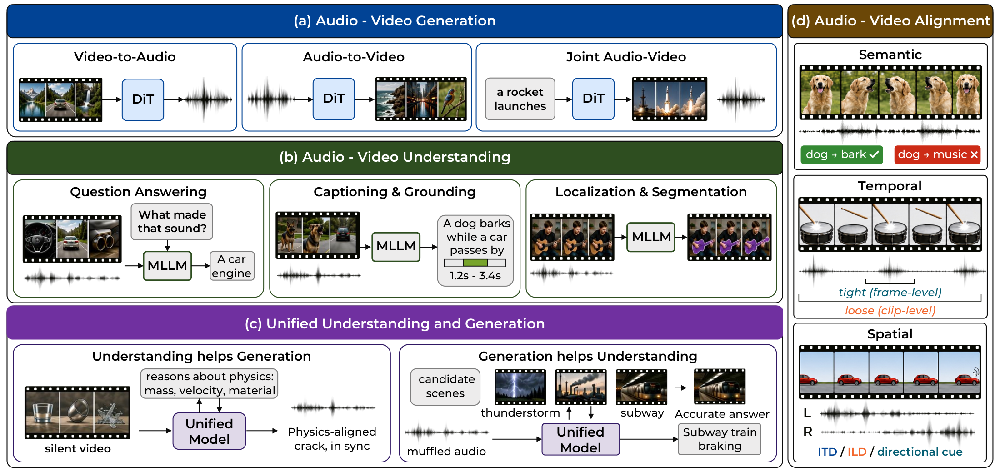

<h1 align="center">Awesome Audio-Video Unification</h1>

<!-- At release, link the arXiv and Project Page badges to their public URLs and replace the Visits placeholder with a counter for the published repository. -->
<p align="center">
  
  
  
</p>

<p align="center">
  <a href="https://hkust.edu.hk/"></a>
  &emsp;
  <a href="https://cqf.io/lab.html"></a>
  &emsp;
  <a href="https://long-group.cse.ust.hk/"></a>
</p>

## ✨ Survey Highlights

> How do models understand sounding video, generate it, and combine both abilities?

- **Unifying Audio-Video Understanding and Generation: Foundations, Taxonomies, and Architectures**  
  [Kien T. Pham](https://tkpham.me/) · Zhenqi He · Yanghao Wang · Qifeng Chen · Long Chen  
  [📖 Survey](paper/arxiv.pdf) · [🗂️ Complete Taxonomy](src/taxonomy_complete.png) · [✒️ BibTeX](#bibtex)
- **Three research pillars:** [Generation](#audio-video-generation) synthesizes one or both streams; [Understanding](#audio-video-understanding) interprets their joint content; [Unified Architectures](#unified-architectures) connect perception and synthesis.
- **Shared foundations:** [Tokenization](#audio-video-tokenization), [Datasets](#awesome-datasets), and [Evaluation](#awesome-benchmarks-and-metrics) cover the representations, training data, and protocols used across those pillars.

<p align="center">
  
</p>

<p align="center">
  <a href="src/av_generation_timeline.png">Generation Timeline</a> ·
  <a href="src/understanding_timeline.png">Understanding Timeline</a> ·
  <a href="src/unification_timeline.png">Unification Timeline</a> ·
  <a href="src/references.bib">BibTeX Library</a>
</p>

---

## Table of Contents

<!-- contents:start -->
- [Research Catalog](#research-catalog)
  - [Awesome Papers](#awesome-papers)
    - [Audio-Video Generation](#audio-video-generation)
      - [Video-to-Audio (V2A)](#video-to-audio-v2a)
      - [Audio-to-Video (A2V)](#audio-to-video-a2v)
      - [Joint Audio-Video Generation](#joint-audio-video-generation)
    - [Audio-Video Understanding](#audio-video-understanding)
      - [Task-Specific Models](#task-specific-models)
      - [Self-Supervised Learning](#self-supervised-learning)
      - [MLLM Generalists](#mllm-generalists)
    - [Unified Architectures](#unified-architectures)
      - [Fully Autoregressive](#fully-autoregressive)
      - [Fully Diffusion](#fully-diffusion)
      - [Decoupled Hybrid](#decoupled-hybrid)
      - [Modular / Agentic](#modular--agentic)
    - [Audio-Video Tokenization](#audio-video-tokenization)
      - [Audio Tokenizers](#audio-tokenizers)
      - [Video Tokenizers](#video-tokenizers)
      - [Joint Audio-Video Tokenization](#joint-audio-video-tokenization)
  - [Awesome Datasets](#awesome-datasets)
    - [Joint Audio-Video Corpora](#joint-audio-video-corpora)
    - [Video Pretraining](#video-pretraining)
    - [Audio Pretraining](#audio-pretraining)
  - [Awesome Benchmarks and Metrics](#awesome-benchmarks-and-metrics)
    - [Benchmarks](#benchmarks)
    - [Metrics](#metrics)
  - [Related Work and Foundations](#related-work-and-foundations)
- [BibTeX](#bibtex)
<!-- contents:end -->

## Research Catalog

The catalog covers all 354 references cited in the survey. Each taxonomy leaf is ordered newest to oldest by the survey’s bibliography year, with titles used to break ties. A work can appear in multiple roles. Titles link to the paper or, for releases without a paper, the release documentation. A dash in Resources means no resource link was confirmed, not necessarily that none exists. A **GitHub** link points to a companion repository, not necessarily a released implementation.

<!-- catalog:start -->
<table>
  <tr><th colspan="4" align="left"><a name="awesome-papers"></a><h3>Awesome Papers</h3></th></tr>
  <tr><th colspan="4" align="left"><a name="audio-video-generation"></a><h3>Audio-Video Generation</h3></th></tr>
  <tr><th colspan="4" align="left"><a name="video-to-audio-v2a"></a><h3>Video-to-Audio (V2A)</h3></th></tr>
  <tr><th scope="col" align="left">Title</th><th scope="col" align="center">Year</th><th scope="col" align="left">Venue</th><th scope="col" align="left">Resources</th></tr>
  <tr><td><a href="https://arxiv.org/abs/2604.10708"><strong>Audio-Omni: Extending Multi-modal Understanding to Versatile Audio Generation and Editing</strong></a></td><td align="center">2026</td><td>arXiv</td><td><a href="https://github.com/ZeyueT/Audio-Omni">Code</a> · <a href="https://zeyuet.github.io/Audio-Omni">Project</a></td></tr>
  <tr><td><a href="https://openreview.net/forum?id=qjJWxK3yWo"><strong>AudioX: A Unified Framework for Anything-to-Audio Generation</strong></a></td><td align="center">2026</td><td>ICLR</td><td><a href="https://github.com/ZeyueT/AudioX">Code</a> · <a href="https://zeyuet.github.io/AudioX/">Project</a></td></tr>
  <tr><td><a href="https://doi.org/10.1016/j.eswa.2025.130688"><strong>MuMu-LLaMA: Multi-modal Music Understanding and Generation via Large Language Models</strong></a></td><td align="center">2026</td><td>Expert Systems with Applications</td><td><a href="https://github.com/shansongliu/MuMu-LLaMA">Code</a> · <a href="https://crypto-code.github.io/MuMu-LLaMA_Demo/">Project</a></td></tr>
  <tr><td><a href="https://arxiv.org/abs/2605.31530"><strong>UNISON: A Unified Sound Generation and Editing Framework via Deep LLM Fusion</strong></a></td><td align="center">2026</td><td>arXiv</td><td><a href="https://github.com/lizhaoqing/UNISON">Code</a> · <a href="https://huggingface.co/jac22/UNISON">Models</a></td></tr>
  <tr><td><a href="https://openaccess.thecvf.com/content/CVPR2025/html/Cheng_MMAudio_Taming_Multimodal_Joint_Training_for_High-Quality_Video-to-Audio_Synthesis_CVPR_2025_paper.html"><strong>MMAudio: Taming Multimodal Joint Training for High-Quality Video-to-Audio Synthesis</strong></a></td><td align="center">2025</td><td>CVPR</td><td><a href="https://github.com/hkchengrex/MMAudio">Code</a> · <a href="https://hkchengrex.com/MMAudio/">Project</a> · <a href="https://huggingface.co/spaces/hkchengrex/MMAudio">Demo</a></td></tr>
  <tr><td><a href="https://arxiv.org/abs/2407.05551"><strong>Read, Watch and Scream! Sound Generation from Text and Video</strong></a></td><td align="center">2025</td><td>AAAI</td><td><a href="https://github.com/naver-ai/rewas">Code</a> · <a href="https://naver-ai.github.io/rewas">Project</a></td></tr>
  <tr><td><a href="https://doi.org/10.1109/icassp49660.2025.10890587"><strong>Temporally aligned audio for video with autoregression</strong></a></td><td align="center">2025</td><td>ICASSP</td><td><a href="https://github.com/ilpoviertola/v-aura">Code</a></td></tr>
  <tr><td><a href="https://openaccess.thecvf.com/content/CVPR2025/html/Kushwaha_VinTAGe_Joint_Video_and_Text_Conditioning_for_Holistic_Audio_Generation_CVPR_2025_paper.html"><strong>VinTAGe: Joint Video and Text Conditioning for Holistic Audio Generation</strong></a></td><td align="center">2025</td><td>CVPR</td><td>—</td></tr>
  <tr><td><a href="https://arxiv.org/abs/2409.07450"><strong>Vmas: Video-to-music generation via semantic alignment in web music videos</strong></a></td><td align="center">2025</td><td>2025 IEEE/CVF Winter Conference on Applications of Computer Vision (WACV)</td><td><a href="https://genjib.github.io/project_page/VMAs/index.html">Project</a></td></tr>
  <tr><td><a href="https://arxiv.org/abs/2407.01494"><strong>FoleyCrafter: Bring Silent Videos to Life with Lifelike and Synchronized Sounds</strong></a></td><td align="center">2024</td><td>arXiv</td><td><a href="https://github.com/open-mmlab/FoleyCrafter">Code</a> · <a href="https://foleycrafter.github.io/">Project</a> · <a href="https://huggingface.co/spaces/ymzhang319/FoleyCrafter">Demo</a></td></tr>
  <tr><td><a href="https://doi.org/10.1109/cvpr52733.2024.00683"><strong>Seeing and Hearing: Open-domain Visual-Audio Generation with Diffusion Latent Aligners</strong></a></td><td align="center">2024</td><td>CVPR</td><td><a href="https://github.com/yzxing87/Seeing-and-Hearing">Code</a></td></tr>
  <tr><td><a href="https://doi.org/10.1109/cvpr52733.2024.02537"><strong>SonicVisionLM: Playing Sound with Vision Language Models</strong></a></td><td align="center">2024</td><td>CVPR</td><td>—</td></tr>
  <tr><td><a href="https://arxiv.org/abs/2308.09300"><strong>V2A-Mapper: A Lightweight Solution for Vision-to-Audio Generation by Connecting Foundation Models</strong></a></td><td align="center">2024</td><td>AAAI</td><td><a href="https://github.com/heng-hw/V2A-Mapper">Code</a></td></tr>
  <tr><td><a href="https://arxiv.org/abs/2306.17203"><strong>Diff-Foley: Synchronized Video-to-Audio Synthesis with Latent Diffusion Models</strong></a></td><td align="center">2023</td><td>NeurIPS</td><td><a href="https://github.com/luosiallen/Diff-Foley">Code</a></td></tr>
  <tr><td><a href="https://arxiv.org/abs/2211.03089"><strong>I Hear Your True Colors: Image Guided Audio Generation</strong></a></td><td align="center">2023</td><td>ICASSP</td><td><a href="https://github.com/RoySheffer/im2wav">Code</a> · <a href="https://pages.cs.huji.ac.il/adiyoss-lab/im2wav/">Project</a></td></tr>
  <tr><td><a href="https://arxiv.org/abs/2311.11255"><strong>M$^2$UGen: Multi-modal Music Understanding and Generation with the Power of Large Language Models</strong></a></td><td align="center">2023</td><td>arXiv</td><td><a href="https://github.com/shansongliu/M2UGen">Code</a></td></tr>
  <tr><td><a href="https://arxiv.org/abs/2110.08791"><strong>Taming Visually Guided Sound Generation</strong></a></td><td align="center">2021</td><td>BMVC</td><td><a href="https://github.com/v-iashin/SpecVQGAN">Code</a> · <a href="http://v-iashin.github.io/SpecVQGAN">Project</a></td></tr>
  <tr><th colspan="4" align="left"><a name="audio-to-video-a2v"></a><h3>Audio-to-Video (A2V)</h3></th></tr>
  <tr><th scope="col" align="left">Title</th><th scope="col" align="center">Year</th><th scope="col" align="left">Venue</th><th scope="col" align="left">Resources</th></tr>
  <tr><td><a href="https://arxiv.org/abs/2601.10103"><strong>FlowAct-R1: Towards Interactive Humanoid Video Generation</strong></a></td><td align="center">2026</td><td>arXiv</td><td><a href="https://grisoon.github.io/FlowAct-R1/">Project</a></td></tr>
  <tr><td><a href="https://arxiv.org/abs/2609.35728"><strong>FlowAct-R2: Beyond Talking Avatar via Streaming Multimodal References and Proactive Agent Planning</strong></a></td><td align="center">2026</td><td>arXiv</td><td><a href="https://bone-11.github.io/Flowact-R2/">Project</a> · <a href="https://huggingface.co/spaces/ProAudience/FlowAct-R2">Demo</a></td></tr>
  <tr><td><a href="https://arxiv.org/abs/2606.22905"><strong>InteractiveAvatar: Real-Time Streaming Video Generation for Consistent and Intent-Aware Avatars</strong></a></td><td align="center">2026</td><td>arXiv</td><td><a href="https://sqymu.github.io/InteractiveAvatar/">Project</a></td></tr>
  <tr><td><a href="https://arxiv.org/abs/2409.17550"><strong>A Simple but Strong Baseline for Sounding Video Generation: Effective Adaptation of Audio and Video Diffusion Models for Joint Generation</strong></a></td><td align="center">2025</td><td>arXiv</td><td><a href="https://github.com/sonyresearch/svg_baseline">Code</a></td></tr>
  <tr><td><a href="https://arxiv.org/abs/2507.19836"><strong>Choreomuse: Robust music-to-dance video generation with style transfer and beat-adherent motion</strong></a></td><td align="center">2025</td><td>ACM MM</td><td><a href="https://choreomuse.github.io/">Project</a></td></tr>
  <tr><td><a href="https://arxiv.org/abs/2508.06511"><strong>DiTalker: A Unified DiT-based Framework for High-Quality and Speaking Styles Controllable Portrait Animation</strong></a></td><td align="center">2025</td><td>arXiv</td><td><a href="https://thenameishope.github.io/DiTalker/">Project</a></td></tr>
  <tr><td><a href="https://arxiv.org/abs/2412.00733"><strong>Hallo3: Highly Dynamic and Realistic Portrait Image Animation with Video Diffusion Transformer</strong></a></td><td align="center">2025</td><td>arXiv</td><td><a href="https://github.com/fudan-generative-vision/hallo3">Code</a> · <a href="https://fudan-generative-vision.github.io/hallo3/">Project</a></td></tr>
  <tr><td><a href="https://arxiv.org/abs/2512.04677"><strong>Live Avatar: Streaming Real-time Audio-Driven Avatar Generation with Infinite Length</strong></a></td><td align="center">2025</td><td>arXiv</td><td><a href="https://github.com/Alibaba-Quark/LiveAvatar">Code</a> · <a href="https://liveavatar.github.io/">Project</a></td></tr>
  <tr><td><a href="https://arxiv.org/abs/2508.00782"><strong>SpA2V: Harnessing Spatial Auditory Cues for Audio-driven Spatially-aware Video Generation</strong></a></td><td align="center">2025</td><td>ACM MM</td><td>—</td></tr>
  <tr><td><a href="https://arxiv.org/abs/2508.18621"><strong>Wan-S2V: Audio-Driven Cinematic Video Generation</strong></a></td><td align="center">2025</td><td>arXiv</td><td>—</td></tr>
  <tr><td><a href="https://arxiv.org/abs/2512.02492"><strong>YingVideo-MV: Music-Driven Multi-Stage Video Generation</strong></a></td><td align="center">2025</td><td>arXiv</td><td><a href="https://github.com/GiantAILab/YingVideo-MV">Code</a> · <a href="https://giantailab.github.io/YingVideo-MV/">Project</a></td></tr>
  <tr><td><a href="https://arxiv.org/abs/2403.17694"><strong>AniPortrait: Audio-Driven Synthesis of Photorealistic Portrait Animation</strong></a></td><td align="center">2024</td><td>arXiv</td><td><a href="https://github.com/scutzzj/aniportrait">Code</a></td></tr>
  <tr><td><a href="https://ojs.aaai.org/index.php/AAAI/article/view/28486"><strong>Diverse and Aligned Audio-to-Video Generation via Text-to-Video Model Adaptation</strong></a></td><td align="center">2024</td><td>AAAI</td><td>—</td></tr>
  <tr><td><a href="https://arxiv.org/abs/2402.17485"><strong>EMO: Emote Portrait Alive -- Generating Expressive Portrait Videos with Audio2Video Diffusion Model under Weak Conditions</strong></a></td><td align="center">2024</td><td>arXiv</td><td>—</td></tr>
  <tr><td><a href="https://arxiv.org/abs/2406.08801"><strong>Hallo: Hierarchical Audio-Driven Visual Synthesis for Portrait Image Animation</strong></a></td><td align="center">2024</td><td>arXiv</td><td><a href="https://github.com/fudan-generative-vision/hallo">Code</a> · <a href="https://fudan-generative-vision.github.io/hallo/#/">Project</a> · <a href="https://huggingface.co/datasets/fudan-generative-ai/hallo_inference_samples">Data</a></td></tr>
  <tr><td><a href="https://arxiv.org/abs/2401.08503"><strong>Real3D-Portrait: One-shot Realistic 3D Talking Portrait Synthesis</strong></a></td><td align="center">2024</td><td>ICLR</td><td><a href="https://github.com/yerfor/Real3DPortrait">Code</a> · <a href="https://real3dportrait.github.io">Project</a></td></tr>
  <tr><td><a href="https://doi.org/10.1109/cvpr52733.2024.00683"><strong>Seeing and Hearing: Open-domain Visual-Audio Generation with Diffusion Latent Aligners</strong></a></td><td align="center">2024</td><td>CVPR</td><td><a href="https://github.com/yzxing87/Seeing-and-Hearing">Code</a></td></tr>
  <tr><td><a href="https://arxiv.org/abs/2406.02511"><strong>V-Express: Conditional Dropout for Progressive Training of Portrait Video Generation</strong></a></td><td align="center">2024</td><td>arXiv</td><td><a href="https://github.com/tencent-ailab/V-Express">Code</a> · <a href="https://tenvence.github.io/p/v-express/">Project</a></td></tr>
  <tr><td><a href="https://openreview.net/forum?id=G1tsqarGAw"><strong>WorldGPT: Empowering LLM as Multimodal World Model</strong></a></td><td align="center">2024</td><td>ACM MM</td><td>—</td></tr>
  <tr><td><a href="https://arxiv.org/abs/2211.12194"><strong>SadTalker: Learning Realistic 3D Motion Coefficients for Stylized Audio-Driven Single Image Talking Face Animation</strong></a></td><td align="center">2023</td><td>CVPR</td><td><a href="https://github.com/winfredy/sadtalker">Code</a></td></tr>
  <tr><td><a href="https://arxiv.org/abs/2309.04509"><strong>The Power of Sound (TPoS): Audio Reactive Video Generation with Stable Diffusion</strong></a></td><td align="center">2023</td><td>arXiv</td><td><a href="https://ku-vai.github.io/TPoS/">Project</a></td></tr>
  <tr><td><a href="https://doi.org/10.1007/978-3-030-58583-9_42"><strong>Sound2Sight: Generating Visual Dynamics from Sound and Context</strong></a></td><td align="center">2020</td><td>ECCV</td><td>—</td></tr>
  <tr><th colspan="4" align="left"><a name="joint-audio-video-generation"></a><h3>Joint Audio-Video Generation</h3></th></tr>
  <tr><th scope="col" align="left">Title</th><th scope="col" align="center">Year</th><th scope="col" align="left">Venue</th><th scope="col" align="left">Resources</th></tr>
  <tr><td><a href="https://arxiv.org/abs/2601.04151"><strong>Apollo: Unified Multi-Task Audio-Video Joint Generation</strong></a></td><td align="center">2026</td><td>arXiv</td><td>—</td></tr>
  <tr><td><a href="https://pika.art/blog/pika-h3-flex"><strong>Introducing Pika H3 Flex</strong></a></td><td align="center">2026</td><td>—</td><td>—</td></tr>
  <tr><td><a href="https://arxiv.org/abs/2602.19163"><strong>JavisDiT++: Unified Modeling and Optimization for Joint Audio-Video Generation</strong></a></td><td align="center">2026</td><td>ICLR</td><td><a href="https://github.com/JavisVerse/JavisDiT">Code</a> · <a href="https://javisverse.github.io/JavisDiT2-page/">Project</a></td></tr>
  <tr><td><a href="https://arxiv.org/abs/2503.23377"><strong>JavisDiT: Joint Audio-Video Diffusion Transformer with Hierarchical Spatio-Temporal Prior Synchronization</strong></a></td><td align="center">2026</td><td>ICLR</td><td><a href="https://github.com/JavisVerse/JavisDiT">Code</a> · <a href="https://javisverse.github.io/JavisDiT-page/">Project</a> · <a href="https://huggingface.co/datasets/JavisVerse/JavisBench">Data</a></td></tr>
  <tr><td><a href="https://arxiv.org/abs/2512.13677"><strong>JoVA: Unified Multimodal Learning for Joint Video-Audio Generation and Editing</strong></a></td><td align="center">2026</td><td>ECCV</td><td><a href="https://github.com/Visual-AI/JoVA">Code</a> · <a href="https://visual-ai.github.io/jova/">Project</a></td></tr>
  <tr><td><a href="https://huggingface.co/Lightricks/LTX-2.3"><strong>LTX-2.3</strong></a></td><td align="center">2026</td><td>—</td><td><a href="https://github.com/Lightricks/LTX-2">Code</a></td></tr>
  <tr><td><a href="https://huggingface.co/Lightricks/LTX-2.5"><strong>LTX-2.5</strong></a></td><td align="center">2026</td><td>—</td><td>—</td></tr>
  <tr><td><a href="https://arxiv.org/abs/2601.03233"><strong>LTX-2: Efficient Joint Audio-Visual Foundation Model</strong></a></td><td align="center">2026</td><td>arXiv</td><td><a href="https://github.com/Lightricks/LTX-2">Code</a> · <a href="https://ltx.io/">Project</a> · <a href="https://app.ltx.studio/ltx-2-playground/i2v">Demo</a></td></tr>
  <tr><td><a href="https://www.minimax.io/blog/minimax-h3"><strong>MiniMax-H3: Open Omni-Modal Video-Audio Generation</strong></a></td><td align="center">2026</td><td>—</td><td><a href="https://github.com/MiniMax-AI/MiniMax-H3">Code</a> · <a href="https://huggingface.co/MiniMaxAI/MiniMax-H3">Models</a></td></tr>
  <tr><td><a href="https://arxiv.org/abs/2608.13602"><strong>Omni-LiveAvatar: Minute-Level Real-Time Streaming Joint Audio-Video Avatar Generation</strong></a></td><td align="center">2026</td><td>arXiv</td><td><a href="https://github.com/Aoko955/Omni-LiveAvatar">GitHub</a> · <a href="https://aoko955.github.io/Omni-LiveAvatar/">Project</a></td></tr>
  <tr><td><a href="https://arxiv.org/abs/2603.21986"><strong>Speed by Simplicity: A Single-Stream Architecture for Fast Audio-Video Generative Foundation Model</strong></a></td><td align="center">2026</td><td>arXiv</td><td><a href="https://github.com/GAIR-NLP/daVinci-MagiHuman">Code</a> · <a href="https://huggingface.co/spaces/SII-GAIR/daVinci-MagiHuman">Demo</a></td></tr>
  <tr><td><a href="https://arxiv.org/abs/2611.03394"><strong>TaoMate-HD: Progressive-Resolution Autoregressive Audio-Video Generation</strong></a></td><td align="center">2026</td><td>arXiv</td><td><a href="https://github.com/TaoLiveAIGC/TaoMate-HD">Code</a> · <a href="https://taoliveaigc.github.io/TaoMate-HD">Project</a></td></tr>
  <tr><td><a href="https://arxiv.org/abs/2607.24359"><strong>TaoMate: Anchor-Guided Memory Bridging Evolving and Reference States for Real-Time Audio-Video Digital Human Generation</strong></a></td><td align="center">2026</td><td>arXiv</td><td><a href="https://github.com/TaoLiveAIGC/TaoMate">Code</a> · <a href="https://taoliveaigc.github.io/TaoMate">Project</a></td></tr>
  <tr><td><a href="https://arxiv.org/abs/2610.24791"><strong>UniAVC: Unified Audio-Video Creation via Progressive Training and Asymmetric Scheduling</strong></a></td><td align="center">2026</td><td>arXiv</td><td><a href="https://github.com/HKUST-LongGroup/UniAVC">Code</a> · <a href="https://hkust-longgroup.github.io/UniAVC">Project</a></td></tr>
  <tr><td><a href="https://arxiv.org/abs/2511.03334"><strong>UniAVGen: Unified Audio and Video Generation with Asymmetric Cross-Modal Interactions</strong></a></td><td align="center">2026</td><td>CVPR</td><td><a href="https://github.com/mcg-nju/sora2-mini">Code</a> · <a href="https://mcg-nju.github.io/UniAVGen/">Project</a></td></tr>
  <tr><td><a href="https://arxiv.org/abs/2607.15038"><strong>Video = World + Event Stream</strong></a></td><td align="center">2026</td><td>arXiv</td><td><a href="https://wan-streamer.com/v0.3/">Project</a></td></tr>
  <tr><td><a href="https://arxiv.org/abs/2606.25041"><strong>Wan-Streamer v0.1: End-to-end Real-time Interactive Foundation Models</strong></a></td><td align="center">2026</td><td>arXiv</td><td><a href="https://wan-streamer.com/">Project</a></td></tr>
  <tr><td><a href="https://arxiv.org/abs/2607.04443"><strong>Wan-Streamer v0.2: Higher Resolution, Same Latency</strong></a></td><td align="center">2026</td><td>arXiv</td><td><a href="https://wan-streamer.com/">Project</a></td></tr>
  <tr><td><a href="https://arxiv.org/abs/2503.08307"><strong>$^R$FLAV: Rolling Flow matching for infinite Audio Video generation</strong></a></td><td align="center">2025</td><td>arXiv</td><td><a href="https://github.com/ErgastiAlex/R-FLAV">Code</a></td></tr>
  <tr><td><a href="https://arxiv.org/abs/2409.17550"><strong>A Simple but Strong Baseline for Sounding Video Generation: Effective Adaptation of Audio and Video Diffusion Models for Joint Generation</strong></a></td><td align="center">2025</td><td>arXiv</td><td><a href="https://github.com/sonyresearch/svg_baseline">Code</a></td></tr>
  <tr><td><a href="https://doi.org/10.1145/3746027.3755713"><strong>AV-DiT: Taming Image Diffusion Transformers for Efficient Joint Audio and Video Generation</strong></a></td><td align="center">2025</td><td>ACM MM</td><td>—</td></tr>
  <tr><td><a href="https://ir.kuaishou.com/news-releases/news-release-details/kling-ai-launches-video-26-model-simultaneous-audio-visual/"><strong>Kling AI Launches Video 2.6 Model with Simultaneous Audio-Visual Generation Capability</strong></a></td><td align="center">2025</td><td>—</td><td>—</td></tr>
  <tr><td><a href="https://arxiv.org/abs/2510.01284"><strong>Ovi: Twin Backbone Cross-Modal Fusion for Audio-Video Generation</strong></a></td><td align="center">2025</td><td>arXiv</td><td><a href="https://github.com/character-ai/Ovi">Code</a> · <a href="https://aaxwaz.github.io/Ovi">Project</a></td></tr>
  <tr><td><a href="https://www.eachlabs.ai/blog/pixverse-v5-5-smarter-video-generation-better-results"><strong>PixVerse v5.5: Smarter Video Generation, Better Results</strong></a></td><td align="center">2025</td><td>—</td><td><a href="https://app.pixverse.ai/">Demo</a></td></tr>
  <tr><td><a href="https://arxiv.org/abs/2512.13507"><strong>Seedance 1.5 pro: A Native Audio-Visual Joint Generation Foundation Model</strong></a></td><td align="center">2025</td><td>arXiv</td><td><a href="https://seed.bytedance.com/seedance1_5_pro">Project</a></td></tr>
  <tr><td><a href="https://openai.com/index/sora-2-system-card/"><strong>Sora 2 System Card</strong></a></td><td align="center">2025</td><td>—</td><td><a href="https://openai.com/index/sora-2/">Project</a></td></tr>
  <tr><td><a href="https://arxiv.org/abs/2509.06155"><strong>UniVerse-1: Unified Audio-Video Generation via Stitching of Experts</strong></a></td><td align="center">2025</td><td>arXiv</td><td><a href="https://github.com/Dorniwang/UniVerse-1-code">Code</a> · <a href="https://dorniwang.github.io/UniVerse-1/">Project</a></td></tr>
  <tr><td><a href="https://deepmind.google/models/veo/"><strong>Veo 3.1: Video Generation with Native Audio</strong></a></td><td align="center">2025</td><td>—</td><td>—</td></tr>
  <tr><td><a href="https://arxiv.org/abs/2412.15191"><strong>AV-Link: Temporally-Aligned Diffusion Features for Cross-Modal Audio-Video Generation</strong></a></td><td align="center">2024</td><td>arXiv</td><td><a href="https://github.com/snap-research/AVLink">Code</a> · <a href="https://snap-research.github.io/AVLink/">Project</a></td></tr>
  <tr><td><a href="https://arxiv.org/abs/2311.18775"><strong>CoDi-2: In-Context, Interleaved, and Interactive Any-to-Any Generation</strong></a></td><td align="center">2024</td><td>arXiv</td><td>—</td></tr>
  <tr><td><a href="https://arxiv.org/abs/2410.13720"><strong>Movie Gen: A Cast of Media Foundation Models</strong></a></td><td align="center">2024</td><td>arXiv</td><td><a href="https://github.com/facebookresearch/MovieGenBench">Code</a></td></tr>
  <tr><td><a href="https://arxiv.org/abs/2305.11846"><strong>Any-to-Any Generation via Composable Diffusion</strong></a></td><td align="center">2023</td><td>NeurIPS</td><td><a href="https://github.com/microsoft/i-Code/tree/main/i-Code-V3">Code</a> · <a href="https://codi-gen.github.io/">Project</a></td></tr>
  <tr><td><a href="https://arxiv.org/abs/2212.09478"><strong>MM-Diffusion: Learning Multi-Modal Diffusion Models for Joint Audio and Video Generation</strong></a></td><td align="center">2023</td><td>CVPR</td><td><a href="https://github.com/researchmm/mm-diffusion">Code</a></td></tr>
  <tr><th colspan="4" align="left"><a name="audio-video-understanding"></a><h3>Audio-Video Understanding</h3></th></tr>
  <tr><th colspan="4" align="left"><a name="task-specific-models"></a><h3>Task-Specific Models</h3></th></tr>
  <tr><th scope="col" align="left">Title</th><th scope="col" align="center">Year</th><th scope="col" align="left">Venue</th><th scope="col" align="left">Resources</th></tr>
  <tr><td><a href="https://openaccess.thecvf.com/content/CVPR2025/html/Kim_Question-Aware_Gaussian_Experts_for_Audio-Visual_Question_Answering_CVPR_2025_paper.html"><strong>Question-Aware Gaussian Experts for Audio-Visual Question Answering</strong></a></td><td align="center">2025</td><td>CVPR</td><td><a href="https://github.com/AIM-SKKU/QA-TIGER">Code</a> · <a href="https://aim-skku.github.io/QA-TIGER/">Project</a></td></tr>
  <tr><td><a href="https://doi.org/10.1609/aaai.v39i14.33608"><strong>Towards Audio-Visual Navigation in Noisy Environments: A Large-Scale Benchmark Dataset and an Architecture Considering Multiple Sound-Sources</strong></a></td><td align="center">2025</td><td>AAAI</td><td>—</td></tr>
  <tr><td><a href="https://arxiv.org/abs/2307.01146"><strong>AVSegFormer: Audio-Visual Segmentation with Transformer</strong></a></td><td align="center">2024</td><td>AAAI</td><td>—</td></tr>
  <tr><td><a href="https://doi.org/10.1109/cvpr52733.2024.02143"><strong>Benchmarking Audio Visual Segmentation for Long-Untrimmed Videos</strong></a></td><td align="center">2024</td><td>CVPR</td><td>—</td></tr>
  <tr><td><a href="https://arxiv.org/abs/2303.07522"><strong>Audio Visual Language Maps for Robot Navigation</strong></a></td><td align="center">2023</td><td>Proceedings of the International Symposium on Experimental Robotics (ISER)</td><td><a href="https://github.com/avlmaps/AVLMaps">Code</a> · <a href="https://avlmaps.github.io/">Project</a></td></tr>
  <tr><td><a href="https://doi.org/10.52202/068431-2720"><strong>A Closer Look at Weakly-Supervised Audio-Visual Source Localization</strong></a></td><td align="center">2022</td><td>NeurIPS</td><td><a href="https://github.com/stoneMo/SLAVC">Code</a></td></tr>
  <tr><td><a href="https://arxiv.org/abs/2107.00135"><strong>Attention Bottlenecks for Multimodal Fusion</strong></a></td><td align="center">2021</td><td>NeurIPS</td><td><a href="https://github.com/google-research/scenic/tree/main/scenic/projects/mbt">Code</a></td></tr>
  <tr><td><a href="https://openreview.net/forum?id=hWr3e3r-oH5"><strong>Cross-Attentional Audio-Visual Fusion for Weakly-Supervised Action Localization</strong></a></td><td align="center">2021</td><td>ICLR</td><td>—</td></tr>
  <tr><td><a href="https://arxiv.org/abs/2008.09622"><strong>Learning to Set Waypoints for Audio-Visual Navigation</strong></a></td><td align="center">2021</td><td>ICLR</td><td><a href="https://github.com/facebookresearch/sound-spaces">Code</a> · <a href="https://vision.cs.utexas.edu/projects/audio_visual_waypoints/">Project</a></td></tr>
  <tr><td><a href="https://doi.org/10.1109/CVPR46437.2021.01659"><strong>Localizing Visual Sounds the Hard Way</strong></a></td><td align="center">2021</td><td>CVPR</td><td><a href="https://github.com/hche11/Localizing-Visual-Sounds-the-Hard-Way">Code</a></td></tr>
  <tr><td><a href="https://doi.org/10.1007/978-3-030-58539-6_2"><strong>Soundspaces: Audio-visual navigation in 3d environments</strong></a></td><td align="center">2020</td><td>ECCV</td><td><a href="https://github.com/facebookresearch/sound-spaces">Code</a></td></tr>
  <tr><td><a href="https://doi.org/10.1007/978-3-030-58580-8_26"><strong>Unified Multisensory Perception: Weakly-Supervised Audio-Visual Video Parsing</strong></a></td><td align="center">2020</td><td>ECCV</td><td><a href="https://github.com/YapengTian/AVVP-ECCV20">Code</a></td></tr>
  <tr><td><a href="https://doi.org/10.1109/ICCV.2019.00559"><strong>EPIC-Fusion: Audio-Visual Temporal Binding for Egocentric Action Recognition</strong></a></td><td align="center">2019</td><td>ICCV</td><td><a href="https://github.com/ekazakos/temporal-binding-network">Code</a></td></tr>
  <tr><td><a href="https://arxiv.org/abs/1904.05979"><strong>The Sound of Motions</strong></a></td><td align="center">2019</td><td>ICCV</td><td><a href="https://github.com/hangzhaomit/Sound-of-Motions">Code</a></td></tr>
  <tr><td><a href="https://doi.org/10.1007/978-3-030-01216-8_16"><strong>Audio-Visual Event Localization in Unconstrained Videos</strong></a></td><td align="center">2018</td><td>ECCV</td><td><a href="https://github.com/YapengTian/AVE-ECCV18">Code</a></td></tr>
  <tr><td><a href="https://arxiv.org/abs/1712.06651"><strong>Objects that Sound</strong></a></td><td align="center">2018</td><td>ECCV</td><td>—</td></tr>
  <tr><td><a href="https://arxiv.org/abs/1804.03160"><strong>The Sound of Pixels</strong></a></td><td align="center">2018</td><td>ECCV</td><td><a href="https://github.com/hangzhaomit/Sound-of-Pixels">Code</a></td></tr>
  <tr><th colspan="4" align="left"><a name="self-supervised-learning"></a><h3>Self-Supervised Learning</h3></th></tr>
  <tr><th scope="col" align="left">Title</th><th scope="col" align="center">Year</th><th scope="col" align="left">Venue</th><th scope="col" align="left">Resources</th></tr>
  <tr><td><a href="https://openaccess.thecvf.com/content/CVPR2026/html/Vyas_Pushing_the_Frontier_of_Audiovisual_Perception_with_Large-Scale_Multimodal_Correspondence_CVPR_2026_paper.html"><strong>Pushing the Frontier of Audiovisual Perception with Large-Scale Multimodal Correspondence Learning</strong></a></td><td align="center">2026</td><td>CVPR</td><td><a href="https://github.com/facebookresearch/perception_models">Code</a> · <a href="https://ai.meta.com/research/publications/pushing-the-frontier-of-audiovisual-perception-with-large-scale-multimodal-correspondence-learning/">Project</a> · <a href="https://huggingface.co/facebook/pe-a-frame-base">Models</a></td></tr>
  <tr><td><a href="https://openaccess.thecvf.com/content/CVPR2025/html/Araujo_CAV-MAE_Sync_Improving_Contrastive_Audio-Visual_Mask_Autoencoders_via_Fine-Grained_Alignment_CVPR_2025_paper.html"><strong>Cav-mae sync: Improving contrastive audio-visual mask autoencoders via fine-grained alignment</strong></a></td><td align="center">2025</td><td>CVPR</td><td>—</td></tr>
  <tr><td><a href="https://arxiv.org/abs/2403.15377"><strong>InternVideo2: Scaling Foundation Models for Multimodal Video Understanding</strong></a></td><td align="center">2024</td><td>ECCV</td><td><a href="https://github.com/OpenGVLab/InternVideo/tree/main/InternVideo2/">Code</a></td></tr>
  <tr><td><a href="https://arxiv.org/abs/2310.01852"><strong>LanguageBind: Extending Video-Language Pretraining to N-modality by Language-based Semantic Alignment</strong></a></td><td align="center">2024</td><td>ICLR</td><td><a href="https://github.com/PKU-YuanGroup/LanguageBind">Code</a></td></tr>
  <tr><td><a href="https://arxiv.org/abs/2210.07839"><strong>Contrastive Audio-Visual Masked Autoencoder</strong></a></td><td align="center">2023</td><td>ICLR</td><td>—</td></tr>
  <tr><td><a href="https://doi.org/10.1109/cvpr52729.2023.01457"><strong>ImageBind: One Embedding Space To Bind Them All</strong></a></td><td align="center">2023</td><td>CVPR</td><td><a href="https://github.com/facebookresearch/ImageBind">Code</a></td></tr>
  <tr><td><a href="https://doi.org/10.1109/icassp49357.2023.10095969"><strong>Large-Scale Contrastive Language-Audio Pretraining with Feature Fusion and Keyword-to-Caption Augmentation</strong></a></td><td align="center">2023</td><td>ICASSP</td><td><a href="https://github.com/laion-ai/clap">Code</a></td></tr>
  <tr><td><a href="https://arxiv.org/abs/2305.11172"><strong>ONE-PEACE: Exploring One General Representation Model Toward Unlimited Modalities</strong></a></td><td align="center">2023</td><td>arXiv</td><td><a href="https://github.com/OFA-Sys/ONE-PEACE">Code</a></td></tr>
  <tr><td><a href="https://arxiv.org/abs/2304.08345"><strong>VALOR: Vision-Audio-Language Omni-Perception Pretraining Model and Dataset</strong></a></td><td align="center">2023</td><td>arXiv</td><td><a href="https://github.com/TXH-mercury/VALOR">Code</a></td></tr>
  <tr><td><a href="https://doi.org/10.1109/ICASSP43922.2022.9747631"><strong>AudioCLIP: Extending CLIP to Image, Text and Audio</strong></a></td><td align="center">2022</td><td>ICASSP</td><td><a href="https://github.com/AndreyGuzhov/AudioCLIP">Code</a></td></tr>
  <tr><td><a href="https://arxiv.org/abs/2207.06405"><strong>Masked Autoencoders that Listen</strong></a></td><td align="center">2022</td><td>NeurIPS</td><td><a href="https://github.com/facebookresearch/AudioMAE">Code</a></td></tr>
  <tr><td><a href="https://arxiv.org/abs/2103.00020"><strong>Learning Transferable Visual Models From Natural Language Supervision</strong></a></td><td align="center">2021</td><td>ICML</td><td><a href="https://github.com/openai/CLIP">Code</a></td></tr>
  <tr><th colspan="4" align="left"><a name="mllm-generalists"></a><h3>MLLM Generalists</h3></th></tr>
  <tr><th scope="col" align="left">Title</th><th scope="col" align="center">Year</th><th scope="col" align="left">Venue</th><th scope="col" align="left">Resources</th></tr>
  <tr><td><a href="https://proceedings.mlr.press/v306/sun26s.html"><strong>video-SALMONN S: Memory-Enhanced Streaming Audio-Visual LLM</strong></a></td><td align="center">2026</td><td>ICML</td><td>—</td></tr>
  <tr><td><a href="https://arxiv.org/abs/2504.02061"><strong>Aligned Better, Listen Better for Audio-Visual Large Language Models</strong></a></td><td align="center">2025</td><td>ICLR</td><td>—</td></tr>
  <tr><td><a href="https://arxiv.org/abs/2403.16276"><strong>AVicuna: Audio-Visual LLM with Interleaver and Context-Boundary Alignment for Temporal Referential Dialogue</strong></a></td><td align="center">2025</td><td>AAAI</td><td>—</td></tr>
  <tr><td><a href="https://arxiv.org/abs/2503.13068"><strong>Crab: A Unified Audio-Visual Scene Understanding Model with Explicit Cooperation</strong></a></td><td align="center">2025</td><td>arXiv</td><td>—</td></tr>
  <tr><td><a href="https://openaccess.thecvf.com/content/CVPR2025/html/Geng_LongVALE_Vision-Audio-Language-Event_Benchmark_Towards_Time-Aware_Omni-Modal_Perception_of_Long_Videos_CVPR_2025_paper.html"><strong>LongVALE: Vision-Audio-Language-Event Benchmark Towards Time-Aware Omni-Modal Perception of Long Videos</strong></a></td><td align="center">2025</td><td>CVPR</td><td><a href="https://github.com/ttgeng233/longvale">Code</a> · <a href="https://ttgeng233.github.io/LongVALE/">Project</a></td></tr>
  <tr><td><a href="https://arxiv.org/abs/2510.15870"><strong>OmniVinci: Enhancing Architecture and Data for Omni-Modal Understanding LLM</strong></a></td><td align="center">2025</td><td>arXiv</td><td><a href="https://github.com/NVlabs/OmniVinci">Code</a> · <a href="https://nvlabs.github.io/OmniVinci/">Project</a></td></tr>
  <tr><td><a href="https://arxiv.org/abs/2402.05889"><strong>CREMA: Generalizable and Efficient Video-Language Reasoning via Multimodal Modular Fusion</strong></a></td><td align="center">2024</td><td>arXiv</td><td><a href="https://github.com/Yui010206/CREMA">Code</a></td></tr>
  <tr><td><a href="https://doi.org/10.52202/079017-3518"><strong>Emotion-LLaMA: Multimodal Emotion Recognition and Reasoning with Instruction Tuning</strong></a></td><td align="center">2024</td><td>NeurIPS</td><td>—</td></tr>
  <tr><td><a href="https://openreview.net/forum?id=nBZBPXdJlC"><strong>Listen, Think, and Understand</strong></a></td><td align="center">2024</td><td>ICLR</td><td><a href="https://github.com/YuanGongND/ltu">Code</a> · <a href="https://huggingface.co/spaces/yuangongfdu/ltu">Demo</a></td></tr>
  <tr><td><a href="https://doi.org/10.1007/978-3-031-73039-9_4"><strong>Meerkat: Audio-Visual Large Language Model for Grounding in Space and Time</strong></a></td><td align="center">2024</td><td>ECCV</td><td>—</td></tr>
  <tr><td><a href="https://github.com/infinigence/Infini-Megrez-Omni"><strong>Megrez-3B-Omni: Efficient Omni-Modal Foundation Model</strong></a></td><td align="center">2024</td><td>—</td><td>—</td></tr>
  <tr><td><a href="https://arxiv.org/abs/2401.08577"><strong>MultiPLY: A Multisensory Object-Centric Embodied Large Language Model in 3D World</strong></a></td><td align="center">2024</td><td>CVPR</td><td><a href="https://vis-www.cs.umass.edu/MultiPLY/">Project</a></td></tr>
  <tr><td><a href="https://arxiv.org/abs/2410.12109"><strong>OMCAT: Omni Context Aware Transformer</strong></a></td><td align="center">2024</td><td>arXiv</td><td><a href="https://om-cat.github.io">Project</a></td></tr>
  <tr><td><a href="https://arxiv.org/abs/2312.03700"><strong>OneLLM: One Framework to Align All Modalities with Language</strong></a></td><td align="center">2024</td><td>CVPR</td><td><a href="https://github.com/csuhan/OneLLM">Code</a></td></tr>
  <tr><td><a href="https://arxiv.org/abs/2310.13289"><strong>SALMONN: Towards Generic Hearing Abilities for Large Language Models</strong></a></td><td align="center">2024</td><td>ICLR</td><td><a href="https://github.com/bytedance/salmonn">Code</a> · <a href="https://huggingface.co/spaces/tsinghua-ee/SALMONN-7B-gradio">Demo</a></td></tr>
  <tr><td><a href="https://arxiv.org/abs/2405.11273"><strong>Uni-MoE: Scaling Unified Multimodal LLMs with Mixture of Experts</strong></a></td><td align="center">2024</td><td>arXiv</td><td><a href="https://github.com/HITsz-TMG/UMOE-Scaling-Unified-Multimodal-LLMs">Code</a></td></tr>
  <tr><td><a href="https://proceedings.mlr.press/v235/sun24l.html"><strong>video-SALMONN: Speech-Enhanced Audio-Visual Large Language Models</strong></a></td><td align="center">2024</td><td>ICML</td><td>—</td></tr>
  <tr><td><a href="https://arxiv.org/abs/2406.07476"><strong>VideoLLaMA 2: Advancing Spatial-Temporal Modeling and Audio Understanding in Video-LLMs</strong></a></td><td align="center">2024</td><td>arXiv</td><td><a href="https://github.com/DAMO-NLP-SG/VideoLLaMA2/tree/audio_visual">Code</a></td></tr>
  <tr><td><a href="https://openreview.net/forum?id=OvoRkDRLVr"><strong>X-InstructBLIP: A Framework for Aligning X-Modal Instruction-Aware Representations to LLMs and Emergent Cross-Modal Reasoning</strong></a></td><td align="center">2024</td><td>ECCV</td><td><a href="https://github.com/artemisp/lavis-xinstructblip">Code</a></td></tr>
  <tr><td><a href="https://arxiv.org/abs/2309.16058"><strong>AnyMAL: An Efficient and Scalable Any-Modality Augmented Language Model</strong></a></td><td align="center">2023</td><td>arXiv</td><td>—</td></tr>
  <tr><td><a href="https://arxiv.org/abs/2312.06720"><strong>Audio-Visual LLM for Video Understanding</strong></a></td><td align="center">2023</td><td>arXiv</td><td>—</td></tr>
  <tr><td><a href="https://arxiv.org/abs/2307.08581"><strong>BuboGPT: Enabling Visual Grounding in Multi-Modal LLMs</strong></a></td><td align="center">2023</td><td>arXiv</td><td><a href="https://github.com/magic-research/bubogpt">Code</a></td></tr>
  <tr><td><a href="https://arxiv.org/abs/2305.16103"><strong>ChatBridge: Bridging Modalities with Large Language Model as a Language Catalyst</strong></a></td><td align="center">2023</td><td>arXiv</td><td><a href="https://github.com/joez17/chatbridge">Code</a></td></tr>
  <tr><td><a href="https://arxiv.org/abs/2303.11403"><strong>eP-ALM: Efficient Perceptual Augmentation of Language Models</strong></a></td><td align="center">2023</td><td>ICCV</td><td><a href="https://github.com/mshukor/eP-ALM">Code</a> · <a href="https://mshukor.github.io/eP-ALM.github.io/">Project</a></td></tr>
  <tr><td><a href="https://arxiv.org/abs/2309.03905"><strong>ImageBind-LLM: Multi-modality Instruction Tuning</strong></a></td><td align="center">2023</td><td>arXiv</td><td><a href="https://github.com/opengvlab/llama-adapter">Code</a></td></tr>
  <tr><td><a href="https://arxiv.org/abs/2308.15930"><strong>LLaSM: Large Language and Speech Model</strong></a></td><td align="center">2023</td><td>arXiv</td><td><a href="https://github.com/linksoul-ai/llasm">Code</a></td></tr>
  <tr><td><a href="https://arxiv.org/abs/2306.09093"><strong>Macaw-LLM: Multi-Modal Language Modeling with Image, Audio, Video, and Text Integration</strong></a></td><td align="center">2023</td><td>arXiv</td><td><a href="https://github.com/lyuchenyang/macaw-llm">Code</a></td></tr>
  <tr><td><a href="https://arxiv.org/abs/2308.11276"><strong>Music Understanding LLaMA: Advancing Text-to-Music Generation with Question Answering and Captioning</strong></a></td><td align="center">2023</td><td>arXiv</td><td><a href="https://github.com/crypto-code/mu-llama">Code</a></td></tr>
  <tr><td><a href="https://arxiv.org/abs/2305.16355"><strong>PandaGPT: One Model to Instruction-Follow Them All</strong></a></td><td align="center">2023</td><td>arXiv</td><td><a href="https://github.com/yxuansu/pandagpt">Code</a> · <a href="https://panda-gpt.github.io/">Project</a></td></tr>
  <tr><td><a href="https://arxiv.org/abs/2305.11834"><strong>Pengi: An Audio Language Model for Audio Tasks</strong></a></td><td align="center">2023</td><td>arXiv</td><td><a href="https://github.com/microsoft/Pengi">Code</a></td></tr>
  <tr><td><a href="https://arxiv.org/abs/2311.07919"><strong>Qwen-Audio: Advancing Universal Audio Understanding via Unified Large-Scale Audio-Language Models</strong></a></td><td align="center">2023</td><td>arXiv</td><td><a href="https://github.com/QwenLM/Qwen-Audio">Code</a></td></tr>
  <tr><td><a href="https://doi.org/10.18653/v1/2023.emnlp-demo.49"><strong>Video-LLaMA: An Instruction-tuned Audio-Visual Language Model for Video Understanding</strong></a></td><td align="center">2023</td><td>EMNLP Demo</td><td><a href="https://github.com/damo-nlp-sg/video-llama">Code</a> · <a href="https://huggingface.co/spaces/DAMO-NLP-SG/Video-LLaMA">Demo</a></td></tr>
  <tr><td><a href="https://arxiv.org/abs/2305.04160"><strong>X-LLM: Bootstrapping Advanced Large Language Models by Treating Multi-Modalities as Foreign Languages</strong></a></td><td align="center">2023</td><td>arXiv</td><td><a href="https://github.com/phellonchen/x-llm">Code</a> · <a href="https://x-llm.github.io">Project</a></td></tr>
  <tr><th colspan="4" align="left"><a name="unified-architectures"></a><h3>Unified Architectures</h3></th></tr>
  <tr><th colspan="4" align="left"><a name="fully-autoregressive"></a><h3>Fully Autoregressive</h3></th></tr>
  <tr><th scope="col" align="left">Title</th><th scope="col" align="center">Year</th><th scope="col" align="left">Venue</th><th scope="col" align="left">Resources</th></tr>
  <tr><td><a href="https://openaccess.thecvf.com/content/CVPR2025/html/Chen_EMOVA_Empowering_Language_Models_to_See_Hear_and_Speak_with_CVPR_2025_paper.html"><strong>EMOVA: Empowering Language Models to See, Hear and Speak with Vivid Emotions</strong></a></td><td align="center">2025</td><td>CVPR</td><td><a href="https://emova-ollm.github.io/">Project</a></td></tr>
  <tr><td><a href="https://arxiv.org/abs/2503.21979"><strong>Harmonizing Visual Representations for Unified Multimodal Understanding and Generation</strong></a></td><td align="center">2025</td><td>arXiv</td><td><a href="https://github.com/wusize/Harmon">Code</a></td></tr>
  <tr><td><a href="https://doi.org/10.18653/v1/2025.emnlp-main.255"><strong>MIO: A Foundation Model on Multimodal Tokens</strong></a></td><td align="center">2025</td><td>EMNLP</td><td><a href="https://github.com/mio-team/mio">Code</a></td></tr>
  <tr><td><a href="https://arxiv.org/abs/2504.06256"><strong>Transfer between Modalities with MetaQueries</strong></a></td><td align="center">2025</td><td>arXiv</td><td><a href="https://xichenpan.com/metaquery">Project</a></td></tr>
  <tr><td><a href="https://arxiv.org/abs/2407.06135"><strong>ANOLE: An Open, Autoregressive, Native Large Multimodal Models for Interleaved Image-Text Generation</strong></a></td><td align="center">2024</td><td>arXiv</td><td><a href="https://github.com/gair-nlp/anole">Code</a> · <a href="https://huggingface.co/spaces/ethanchern/Anole">Demo</a></td></tr>
  <tr><td><a href="https://arxiv.org/abs/2402.12226"><strong>AnyGPT: Unified Multimodal LLM with Discrete Sequence Modeling</strong></a></td><td align="center">2024</td><td>arXiv</td><td><a href="https://github.com/OpenMOSS/AnyGPT">Code</a> · <a href="https://junzhan2000.github.io/AnyGPT.github.io/">Project</a></td></tr>
  <tr><td><a href="https://arxiv.org/abs/2405.09818"><strong>Chameleon: Mixed-Modal Early-Fusion Foundation Models</strong></a></td><td align="center">2024</td><td>arXiv</td><td><a href="https://github.com/facebookresearch/chameleon">Code</a></td></tr>
  <tr><td><a href="https://arxiv.org/abs/2409.18869"><strong>Emu3: Next-Token Prediction is All You Need</strong></a></td><td align="center">2024</td><td>arXiv</td><td><a href="https://github.com/baaivision/emu3">Code</a></td></tr>
  <tr><td><a href="https://arxiv.org/abs/2412.06673"><strong>ILLUME: Illuminating Your LLMs to See, Draw, and Self-Enhance</strong></a></td><td align="center">2024</td><td>arXiv</td><td>—</td></tr>
  <tr><td><a href="https://arxiv.org/abs/2412.04332"><strong>Liquid: Language Models are Scalable and Unified Multi-modal Generators</strong></a></td><td align="center">2024</td><td>arXiv</td><td><a href="https://github.com/FoundationVision/Liquid">Code</a> · <a href="https://foundationvision.github.io/Liquid/">Project</a></td></tr>
  <tr><td><a href="https://arxiv.org/abs/2412.09604"><strong>SynerGen-VL: Towards Synergistic Image Understanding and Generation with Vision Experts and Token Folding</strong></a></td><td align="center">2024</td><td>arXiv</td><td>—</td></tr>
  <tr><td><a href="https://arxiv.org/abs/2312.17172"><strong>Unified-IO 2: Scaling Autoregressive Multimodal Models with Vision, Language, Audio, and Action</strong></a></td><td align="center">2024</td><td>CVPR</td><td><a href="https://github.com/allenai/unified-io-2">Code</a> · <a href="https://unified-io-2.allenai.org/">Project</a></td></tr>
  <tr><td><a href="https://arxiv.org/abs/2402.08268"><strong>World model on million-length video and language with blockwise ringattention</strong></a></td><td align="center">2024</td><td>arXiv</td><td><a href="https://github.com/LargeWorldModel/LWM">Code</a></td></tr>
  <tr><th colspan="4" align="left"><a name="fully-diffusion"></a><h3>Fully Diffusion</h3></th></tr>
  <tr><th scope="col" align="left">Title</th><th scope="col" align="center">Year</th><th scope="col" align="left">Venue</th><th scope="col" align="left">Resources</th></tr>
  <tr><td><a href="https://arxiv.org/abs/2505.20147"><strong>FUDOKI: Discrete Flow-based Unified Understanding and Generation via Kinetic-Optimal Velocities</strong></a></td><td align="center">2025</td><td>arXiv</td><td>—</td></tr>
  <tr><td><a href="https://arxiv.org/abs/2505.15809"><strong>MMaDA: Multimodal Large Diffusion Language Models</strong></a></td><td align="center">2025</td><td>NeurIPS</td><td><a href="https://github.com/Gen-Verse/MMaDA">Code</a> · <a href="https://huggingface.co/spaces/Gen-Verse/MMaDA">Demo</a></td></tr>
  <tr><td><a href="https://arxiv.org/abs/2505.23606"><strong>Muddit: Liberating Generation Beyond Text-to-Image with a Unified Discrete Diffusion Model</strong></a></td><td align="center">2025</td><td>arXiv</td><td><a href="https://github.com/M-E-AGI-Lab/Muddit">Code</a></td></tr>
  <tr><td><a href="https://arxiv.org/abs/2503.20853"><strong>Unified Multimodal Discrete Diffusion</strong></a></td><td align="center">2025</td><td>arXiv</td><td>—</td></tr>
  <tr><td><a href="https://arxiv.org/abs/2501.00289"><strong>Dual Diffusion for Unified Image Generation and Understanding</strong></a></td><td align="center">2024</td><td>arXiv</td><td><a href="https://github.com/zijieli-Jlee/Dual-Diffusion">Code</a> · <a href="https://zijieli-jlee.github.io/dualdiff.github.io/">Project</a></td></tr>
  <tr><th colspan="4" align="left"><a name="decoupled-hybrid"></a><h3>Decoupled Hybrid</h3></th></tr>
  <tr><th scope="col" align="left">Title</th><th scope="col" align="center">Year</th><th scope="col" align="left">Venue</th><th scope="col" align="left">Resources</th></tr>
  <tr><td><a href="https://arxiv.org/abs/2606.02800"><strong>Cosmos 3: Omnimodal World Models for Physical AI</strong></a></td><td align="center">2026</td><td>arXiv</td><td><a href="https://github.com/NVIDIA/cosmos">Code</a> · <a href="https://research.nvidia.com/labs/cosmos-lab/cosmos3/index.html">Project</a> · <a href="https://huggingface.co/collections/nvidia/cosmos3">Models</a></td></tr>
  <tr><td><a href="https://arxiv.org/abs/2512.03034"><strong>MAViD: A Multimodal Framework for Audio-Visual Dialogue Understanding and Generation</strong></a></td><td align="center">2026</td><td>SIGGRAPH</td><td><a href="https://carlyx.github.io/MAViD/">Project</a></td></tr>
  <tr><td><a href="https://arxiv.org/abs/2501.15368"><strong>Baichuan-Omni-1.5 Technical Report</strong></a></td><td align="center">2025</td><td>arXiv</td><td><a href="https://github.com/baichuan-inc/baichuan-omni-1.5">Code</a></td></tr>
  <tr><td><a href="https://arxiv.org/abs/2505.09568"><strong>BLIP3-o: A Family of Fully Open Unified Multimodal Models -- Architecture, Training and Dataset</strong></a></td><td align="center">2025</td><td>arXiv</td><td><a href="https://github.com/BLIP3o/BLIP3o">Code</a></td></tr>
  <tr><td><a href="https://arxiv.org/abs/2505.14683"><strong>Emerging Properties in Unified Multimodal Pretraining</strong></a></td><td align="center">2025</td><td>arXiv</td><td><a href="https://github.com/ByteDance-Seed/Bagel">Code</a> · <a href="https://bagel-ai.org/">Project</a></td></tr>
  <tr><td><a href="https://arxiv.org/abs/2512.04810"><strong>EMMA: Efficient Multimodal Understanding, Generation, and Editing with a Unified Architecture</strong></a></td><td align="center">2025</td><td>arXiv</td><td>—</td></tr>
  <tr><td><a href="https://arxiv.org/abs/2501.17811"><strong>Janus-Pro: Unified Multimodal Understanding and Generation with Data and Model Scaling</strong></a></td><td align="center">2025</td><td>arXiv</td><td><a href="https://github.com/deepseek-ai/janus">Code</a></td></tr>
  <tr><td><a href="https://doi.org/10.1109/CVPR52734.2025.00725"><strong>JanusFlow: Harmonizing Autoregression and Rectified Flow for Unified Multimodal Understanding and Generation</strong></a></td><td align="center">2025</td><td>CVPR</td><td><a href="https://github.com/deepseek-ai/Janus">Code</a></td></tr>
  <tr><td><a href="https://arxiv.org/abs/2512.22905"><strong>JavisGPT: A Unified Multi-modal LLM for Sounding-Video Comprehension and Generation</strong></a></td><td align="center">2025</td><td>NeurIPS</td><td><a href="https://github.com/JavisVerse/JavisGPT">Code</a></td></tr>
  <tr><td><a href="https://arxiv.org/abs/2502.18778"><strong>M2-Omni: Advancing Omni-MLLM for Comprehensive Modality Support with Competitive Performance</strong></a></td><td align="center">2025</td><td>arXiv</td><td>—</td></tr>
  <tr><td><a href="https://arxiv.org/abs/2506.09344"><strong>Ming-Omni: A Unified Multimodal Model for Perception and Generation</strong></a></td><td align="center">2025</td><td>arXiv</td><td><a href="https://github.com/inclusionAI/Ming">Code</a> · <a href="https://lucaria-academy.github.io/Ming-Omni">Project</a></td></tr>
  <tr><td><a href="https://huggingface.co/openbmb/MiniCPM-o-2_6"><strong>MiniCPM-o 2.6: A GPT-4o Level MLLM for Vision, Speech and Multimodal Live Streaming on Your Phone</strong></a></td><td align="center">2025</td><td>—</td><td><a href="https://github.com/OpenBMB/MiniCPM-o">Code</a></td></tr>
  <tr><td><a href="https://doi.org/10.1109/CVPR52734.2025.00747"><strong>MMAR: Towards Lossless Multi-Modal Auto-Regressive Probabilistic Modeling</strong></a></td><td align="center">2025</td><td>CVPR</td><td>—</td></tr>
  <tr><td><a href="https://arxiv.org/abs/2503.08686"><strong>OmniMamba: Efficient and Unified Multimodal Understanding and Generation via State Space Models</strong></a></td><td align="center">2025</td><td>arXiv</td><td><a href="https://github.com/hustvl/omnimamba">Code</a></td></tr>
  <tr><td><a href="https://arxiv.org/abs/2503.20215"><strong>Qwen2.5-Omni Technical Report</strong></a></td><td align="center">2025</td><td>arXiv</td><td><a href="https://github.com/QwenLM/Qwen2.5-Omni">Code</a> · <a href="https://qwenlm.github.io/blog/qwen2.5-omni/">Project</a></td></tr>
  <tr><td><a href="https://arxiv.org/abs/2509.17765"><strong>Qwen3-Omni Technical Report</strong></a></td><td align="center">2025</td><td>arXiv</td><td><a href="https://github.com/QwenLM/Qwen3-Omni">Code</a></td></tr>
  <tr><td><a href="https://arxiv.org/abs/2506.15564"><strong>Show-o2: Improved Native Unified Multimodal Models</strong></a></td><td align="center">2025</td><td>arXiv</td><td><a href="https://github.com/showlab/Show-o">Code</a> · <a href="https://huggingface.co/spaces/showlab/Show-o">Demo</a></td></tr>
  <tr><td><a href="https://arxiv.org/abs/2408.12528"><strong>Show-o: One Single Transformer to Unify Multimodal Understanding and Generation</strong></a></td><td align="center">2025</td><td>ICLR</td><td><a href="https://github.com/showlab/Show-o">Code</a></td></tr>
  <tr><td><a href="https://arxiv.org/abs/2503.13436"><strong>Unified Autoregressive Visual Generation and Understanding with Continuous Tokens</strong></a></td><td align="center">2025</td><td>arXiv</td><td>—</td></tr>
  <tr><td><a href="https://arxiv.org/abs/2501.12327"><strong>VARGPT: Unified Understanding and Generation in a Visual Autoregressive Multimodal Large Language Model</strong></a></td><td align="center">2025</td><td>arXiv</td><td><a href="https://github.com/VARGPT-family/VARGPT">Code</a> · <a href="https://vargpt-1.github.io/">Project</a> · <a href="https://huggingface.co/datasets/VARGPT-family/VARGPT_datasets">Data</a> · <a href="https://huggingface.co/VARGPT-family/VARGPT_LLaVA-v1">Models</a></td></tr>
  <tr><td><a href="https://arxiv.org/abs/2409.04429"><strong>VILA-U: A Unified Foundation Model Integrating Visual Understanding and Generation</strong></a></td><td align="center">2025</td><td>ICLR</td><td><a href="https://github.com/mit-han-lab/vila-u">Code</a></td></tr>
  <tr><td><a href="https://openreview.net/forum?id=8PUzLga3lU"><strong>VITA-1.5: Towards GPT-4o Level Real-Time Vision and Speech Interaction</strong></a></td><td align="center">2025</td><td>NeurIPS</td><td><a href="https://github.com/VITA-MLLM/VITA">Code</a> · <a href="https://huggingface.co/spaces/VITA-MLLM/VITA-1.5">Demo</a></td></tr>
  <tr><td><a href="https://openreview.net/forum?id=mL8Q9OOamV"><strong>Emu: Generative Pretraining in Multimodality</strong></a></td><td align="center">2024</td><td>ICLR</td><td>—</td></tr>
  <tr><td><a href="https://arxiv.org/abs/2410.13848"><strong>Janus: Decoupling Visual Encoding for Unified Multimodal Understanding and Generation</strong></a></td><td align="center">2024</td><td>arXiv</td><td><a href="https://github.com/deepseek-ai/Janus">Code</a></td></tr>
  <tr><td><a href="https://arxiv.org/abs/2412.15188"><strong>LMFusion: Adapting Pretrained Language Models for Multimodal Generation</strong></a></td><td align="center">2024</td><td>arXiv</td><td>—</td></tr>
  <tr><td><a href="https://arxiv.org/abs/2412.09501"><strong>Lyra: An Efficient and Speech-Centric Framework for Omni-Cognition</strong></a></td><td align="center">2024</td><td>arXiv</td><td><a href="https://github.com/dvlab-research/Lyra">Code</a></td></tr>
  <tr><td><a href="https://arxiv.org/abs/2410.11190"><strong>Mini-Omni2: Towards Open-source GPT-4o with Vision, Speech and Duplex Capabilities</strong></a></td><td align="center">2024</td><td>arXiv</td><td><a href="https://github.com/gpt-omni/mini-omni2">Code</a></td></tr>
  <tr><td><a href="https://arxiv.org/abs/2409.16280"><strong>MonoFormer: One Transformer for Both Diffusion and Autoregression</strong></a></td><td align="center">2024</td><td>arXiv</td><td><a href="https://github.com/monoformer/monoformer">Code</a> · <a href="https://monoformer.github.io/">Project</a></td></tr>
  <tr><td><a href="https://arxiv.org/abs/2411.17762"><strong>MUSE-VL: Modeling Unified VLM through Semantic Discrete Encoding</strong></a></td><td align="center">2024</td><td>arXiv</td><td>—</td></tr>
  <tr><td><a href="https://arxiv.org/abs/2404.14396"><strong>SEED-X: Multimodal Models with Unified Multi-Granularity Comprehension and Generation</strong></a></td><td align="center">2024</td><td>arXiv</td><td><a href="https://github.com/ailab-cvc/seed-x">Code</a></td></tr>
  <tr><td><a href="https://arxiv.org/abs/2412.03069"><strong>Tokenflow: Unified Image Tokenizer for Multimodal Understanding and Generation</strong></a></td><td align="center">2024</td><td>arXiv</td><td><a href="https://github.com/ByteFlow-AI/TokenFlow">Code</a> · <a href="https://byteflow-ai.github.io/TokenFlow/">Project</a></td></tr>
  <tr><td><a href="https://arxiv.org/abs/2408.11039"><strong>Transfusion: Predict the Next Token and Diffuse Images with One Multi-Modal Model</strong></a></td><td align="center">2024</td><td>arXiv</td><td>—</td></tr>
  <tr><td><a href="https://arxiv.org/abs/2402.03161"><strong>Video-LaVIT: Unified Video-Language Pre-training with Decoupled Visual-Motional Tokenization</strong></a></td><td align="center">2024</td><td>arXiv</td><td><a href="https://github.com/jy0205/lavit">Code</a></td></tr>
  <tr><td><a href="https://arxiv.org/abs/2309.11499"><strong>DreamLLM: Synergistic Multimodal Comprehension and Creation</strong></a></td><td align="center">2023</td><td>arXiv</td><td><a href="https://github.com/RunpeiDong/DreamLLM">Code</a> · <a href="https://dreamllm.github.io">Project</a></td></tr>
  <tr><td><a href="https://arxiv.org/abs/2310.01218"><strong>Making LLaMA See and Draw with SEED Tokenizer</strong></a></td><td align="center">2023</td><td>arXiv</td><td><a href="https://github.com/AILab-CVC/SEED">Code</a></td></tr>
  <tr><td><a href="https://arxiv.org/abs/2307.08041"><strong>Planting a Seed of Vision in Large Language Model</strong></a></td><td align="center">2023</td><td>arXiv</td><td><a href="https://github.com/AILab-CVC/SEED">Code</a> · <a href="https://huggingface.co/spaces/AILab-CVC/SEED-LLaMA">Demo</a></td></tr>
  <tr><td><a href="https://arxiv.org/abs/2309.04669"><strong>Unified Language-Vision Pretraining in LLM with Dynamic Discrete Visual Tokenization</strong></a></td><td align="center">2023</td><td>arXiv</td><td><a href="https://github.com/jy0205/LaVIT">Code</a></td></tr>
  <tr><th colspan="4" align="left"><a name="modular--agentic"></a><h3>Modular / Agentic</h3></th></tr>
  <tr><th scope="col" align="left">Title</th><th scope="col" align="center">Year</th><th scope="col" align="left">Venue</th><th scope="col" align="left">Resources</th></tr>
  <tr><td><a href="https://openreview.net/pdf/462424e66f7fea533a443a35104ca1dae8e95518.pdf"><strong>Efficient Generative Multimodal Integration (EGMI): Enabling Audio Generation from Text-Image Pairs through Alignment with Large Language Models</strong></a></td><td align="center">2024</td><td>—</td><td>—</td></tr>
  <tr><td><a href="https://arxiv.org/abs/2406.15177"><strong>EmpathyEar: An Open-source Avatar Multimodal Empathetic Chatbot</strong></a></td><td align="center">2024</td><td>arXiv</td><td>—</td></tr>
  <tr><td><a href="https://doi.org/10.1109/cvpr52733.2024.02512"><strong>ModaVerse: Efficiently Transforming Modalities with LLMs</strong></a></td><td align="center">2024</td><td>CVPR</td><td><a href="https://github.com/xinke-wang/ModaVerse">Code</a></td></tr>
  <tr><td><a href="https://arxiv.org/abs/2309.05519"><strong>NExT-GPT: Any-to-Any Multimodal LLM</strong></a></td><td align="center">2024</td><td>ICML</td><td>—</td></tr>
  <tr><td><a href="https://arxiv.org/abs/2411.09439"><strong>Spider: Any-to-Many Multimodal LLM</strong></a></td><td align="center">2024</td><td>arXiv</td><td><a href="https://github.com/Layjins/Spider">Code</a></td></tr>
  <tr><td><a href="https://arxiv.org/abs/2411.05903"><strong>Towards Multi-Modal Mastery: A 4.5B Parameter Truly Multi-Modal Small Language Model</strong></a></td><td align="center">2024</td><td>arXiv</td><td>—</td></tr>
  <tr><td><a href="https://arxiv.org/abs/2408.02503"><strong>UnifiedMLLM: Enabling Unified Representation for Multi-modal Multi-tasks With Large Language Model</strong></a></td><td align="center">2024</td><td>arXiv</td><td><a href="https://github.com/lzw-lzw/unifiedmllm">Code</a></td></tr>
  <tr><td><a href="https://arxiv.org/abs/2408.05211"><strong>VITA: Towards Open-Source Interactive Omni Multimodal LLM</strong></a></td><td align="center">2024</td><td>arXiv</td><td><a href="https://github.com/vita-mllm/vita">Code</a> · <a href="https://vita-home.github.io">Project</a></td></tr>
  <tr><td><a href="https://arxiv.org/abs/2405.19335"><strong>X-VILA: Cross-Modality Alignment for Large Language Model</strong></a></td><td align="center">2024</td><td>arXiv</td><td>—</td></tr>
  <tr><td><a href="https://arxiv.org/abs/2304.12995"><strong>AudioGPT: Understanding and Generating Speech, Music, Sound, and Talking Head</strong></a></td><td align="center">2023</td><td>arXiv</td><td><a href="https://github.com/AIGC-Audio/AudioGPT">Code</a></td></tr>
  <tr><td><a href="https://arxiv.org/abs/2303.17580"><strong>HuggingGPT: Solving AI Tasks with ChatGPT and its Friends in HuggingFace</strong></a></td><td align="center">2023</td><td>NeurIPS</td><td><a href="https://github.com/microsoft/JARVIS">Code</a> · <a href="https://huggingface.co/spaces/microsoft/HuggingGPT">Demo</a></td></tr>
  <tr><td><a href="https://arxiv.org/abs/2310.11954"><strong>MusicAgent: An AI Agent for Music Understanding and Generation with Large Language Models</strong></a></td><td align="center">2023</td><td>arXiv</td><td><a href="https://github.com/microsoft/muzic">Code</a></td></tr>
  <tr><td><a href="https://arxiv.org/abs/2303.04671"><strong>Visual ChatGPT: Talking, Drawing and Editing with Visual Foundation Models</strong></a></td><td align="center">2023</td><td>arXiv</td><td><a href="https://github.com/microsoft/visual-chatgpt">Code</a></td></tr>
  <tr><th colspan="4" align="left"><a name="audio-video-tokenization"></a><h3>Audio-Video Tokenization</h3></th></tr>
  <tr><th colspan="4" align="left"><a name="audio-tokenizers"></a><h3>Audio Tokenizers</h3></th></tr>
  <tr><th scope="col" align="left">Title</th><th scope="col" align="center">Year</th><th scope="col" align="left">Venue</th><th scope="col" align="left">Resources</th></tr>
  <tr><td><a href="https://doi.org/10.18653/v1/2025.acl-long.654"><strong>Language-Codec: Bridging Discrete Codec Representations and Speech Language Models</strong></a></td><td align="center">2025</td><td>ACL</td><td><a href="https://github.com/jishengpeng/languagecodec">Code</a></td></tr>
  <tr><td><a href="https://arxiv.org/abs/2407.14358"><strong>Stable Audio Open</strong></a></td><td align="center">2025</td><td>ICASSP</td><td><a href="https://github.com/Stability-AI/stable-audio-tools">Code</a> · <a href="https://stability-ai.github.io/stable-audio-open-demo/">Project</a> · <a href="https://huggingface.co/stabilityai/stable-audio-open-1.0">Models</a></td></tr>
  <tr><td><a href="https://arxiv.org/abs/2502.20067"><strong>UniCodec: Unified Audio Codec with Single Domain-Adaptive Codebook</strong></a></td><td align="center">2025</td><td>arXiv</td><td>—</td></tr>
  <tr><td><a href="https://arxiv.org/abs/2408.16532"><strong>Wavtokenizer: an efficient acoustic discrete codec tokenizer for audio language modeling</strong></a></td><td align="center">2025</td><td>ICLR</td><td><a href="https://github.com/jishengpeng/WavTokenizer">Code</a> · <a href="https://huggingface.co/novateur/WavTokenizer-large-speech-75token">Models</a></td></tr>
  <tr><td><a href="https://doi.org/10.1109/taslp.2024.3399607"><strong>AudioLDM 2: Learning Holistic Audio Generation with Self-supervised Pretraining</strong></a></td><td align="center">2024</td><td>IEEE/ACM Transactions on Audio, Speech, and Language Processing</td><td>—</td></tr>
  <tr><td><a href="https://arxiv.org/abs/2306.00107"><strong>MERT: Acoustic Music Understanding Model with Large-Scale Self-supervised Training</strong></a></td><td align="center">2024</td><td>ICLR</td><td>—</td></tr>
  <tr><td><a href="https://arxiv.org/abs/2308.16692"><strong>SpeechTokenizer: Unified Speech Tokenizer for Speech Language Models</strong></a></td><td align="center">2024</td><td>ICLR</td><td>—</td></tr>
  <tr><td><a href="https://proceedings.mlr.press/v202/chen23ag.html"><strong>BEATs: Audio Pre-Training with Acoustic Tokenizers</strong></a></td><td align="center">2023</td><td>ICML</td><td>—</td></tr>
  <tr><td><a href="https://arxiv.org/abs/2306.06546"><strong>High-Fidelity Audio Compression with Improved RVQGAN</strong></a></td><td align="center">2023</td><td>NeurIPS</td><td><a href="https://github.com/descriptinc/descript-audio-codec">Code</a></td></tr>
  <tr><td><a href="https://doi.org/10.1109/icassp49357.2023.10095969"><strong>Large-Scale Contrastive Language-Audio Pretraining with Feature Fusion and Keyword-to-Caption Augmentation</strong></a></td><td align="center">2023</td><td>ICASSP</td><td><a href="https://github.com/laion-ai/clap">Code</a></td></tr>
  <tr><td><a href="https://arxiv.org/abs/2212.04356"><strong>Robust Speech Recognition via Large-Scale Weak Supervision</strong></a></td><td align="center">2023</td><td>ICML</td><td><a href="https://github.com/openai/whisper">Code</a></td></tr>
  <tr><td><a href="https://arxiv.org/abs/2210.13438"><strong>High Fidelity Neural Audio Compression</strong></a></td><td align="center">2022</td><td>arXiv</td><td><a href="https://github.com/facebookresearch/encodec">Code</a></td></tr>
  <tr><td><a href="https://arxiv.org/abs/2207.06405"><strong>Masked Autoencoders that Listen</strong></a></td><td align="center">2022</td><td>NeurIPS</td><td><a href="https://github.com/facebookresearch/AudioMAE">Code</a></td></tr>
  <tr><td><a href="https://doi.org/10.1109/taslp.2021.3129994"><strong>SoundStream: An End-to-End Neural Audio Codec</strong></a></td><td align="center">2022</td><td>IEEE/ACM Trans. Audio, Speech, Language Process.</td><td>—</td></tr>
  <tr><td><a href="https://doi.org/10.21437/interspeech.2021-698"><strong>AST: Audio Spectrogram Transformer</strong></a></td><td align="center">2021</td><td>Interspeech</td><td><a href="https://github.com/YuanGongND/ast">Code</a></td></tr>
  <tr><td><a href="https://openreview.net/forum?id=UKprVqG8N7K"><strong>HuBERT: Self-Supervised Speech Representation Learning by Masked Prediction of Hidden Units</strong></a></td><td align="center">2021</td><td>IEEE/ACM Trans. Audio, Speech, Language Process.</td><td><a href="https://github.com/facebookresearch/fairseq">Code</a></td></tr>
  <tr><td><a href="https://arxiv.org/abs/2108.06209"><strong>w2v-BERT: Combining Contrastive Learning and Masked Language Modeling for Self-Supervised Speech Pre-Training</strong></a></td><td align="center">2021</td><td>arXiv</td><td>—</td></tr>
  <tr><th colspan="4" align="left"><a name="video-tokenizers"></a><h3>Video Tokenizers</h3></th></tr>
  <tr><th scope="col" align="left">Title</th><th scope="col" align="center">Year</th><th scope="col" align="left">Venue</th><th scope="col" align="left">Resources</th></tr>
  <tr><td><a href="https://openreview.net/forum?id=JEYWpFGzvn"><strong>InfoTok: Adaptive Discrete Video Tokenizer via Information-Theoretic Compression</strong></a></td><td align="center">2026</td><td>ICLR</td><td><a href="https://github.com/YWolfeee/InfoTok">Code</a></td></tr>
  <tr><td><a href="https://proceedings.mlr.press/v306/atanov26a.html"><strong>VideoFlexTok: Flexible-Length Coarse-to-Fine Video Tokenization</strong></a></td><td align="center">2026</td><td>ICML</td><td><a href="https://github.com/apple-aiml-research/ml-videoflextok">Code</a> · <a href="https://videoflextok.epfl.ch/">Project</a> · <a href="https://huggingface.co/EPFL-VILAB/videoflextok_d18_d28">Models</a></td></tr>
  <tr><td><a href="https://arxiv.org/abs/2512.10942"><strong>VL-JEPA: Joint Embedding Predictive Architecture for Vision-language</strong></a></td><td align="center">2026</td><td>ICLR</td><td>—</td></tr>
  <tr><td><a href="https://arxiv.org/abs/2408.06072"><strong>CogVideoX: Text-to-Video Diffusion Models with An Expert Transformer</strong></a></td><td align="center">2025</td><td>ICLR</td><td><a href="https://github.com/THUDM/CogVideo">Code</a></td></tr>
  <tr><td><a href="https://arxiv.org/abs/2501.03575"><strong>Cosmos World Foundation Model Platform for Physical AI</strong></a></td><td align="center">2025</td><td>arXiv</td><td><a href="https://github.com/nvidia-cosmos/cosmos-predict1">Code</a> · <a href="https://research.nvidia.com/labs/dir/cosmos1/">Project</a></td></tr>
  <tr><td><a href="https://arxiv.org/abs/2410.21264"><strong>Larp: Tokenizing videos with a learned autoregressive generative prior</strong></a></td><td align="center">2025</td><td>ICLR</td><td>—</td></tr>
  <tr><td><a href="https://arxiv.org/abs/2505.17011"><strong>Learning adaptive and temporally causal video tokenization in a 1d latent space</strong></a></td><td align="center">2025</td><td>arXiv</td><td><a href="https://github.com/VisionXLab/AdapTok">Code</a></td></tr>
  <tr><td><a href="https://arxiv.org/abs/2504.13181"><strong>Perception encoder: The best visual embeddings are not at the output of the network</strong></a></td><td align="center">2025</td><td>arXiv</td><td><a href="https://github.com/facebookresearch/perception_models">Code</a></td></tr>
  <tr><td><a href="https://arxiv.org/abs/2502.14786"><strong>Siglip 2: Multilingual vision-language encoders with improved semantic understanding, localization, and dense features</strong></a></td><td align="center">2025</td><td>arXiv</td><td><a href="https://github.com/google-research/big_vision/tree/main/big_vision/configs/proj/image_text/README_siglip2.md">Code</a> · <a href="https://github.com/google-research/big_vision/blob/main/big_vision/configs/proj/image_text/README_siglip2.md">Project</a></td></tr>
  <tr><td><a href="https://arxiv.org/abs/2506.09985"><strong>V-JEPA~2: Self-Supervised Video Models Enable Understanding, Prediction and Planning</strong></a></td><td align="center">2025</td><td>arXiv</td><td><a href="https://github.com/facebookresearch/vjepa2">Code</a></td></tr>
  <tr><td><a href="https://arxiv.org/abs/2412.17805"><strong>VideoVAE+: Large Motion Video Autoencoding with Cross-modal Video VAE</strong></a></td><td align="center">2025</td><td>ICCV</td><td><a href="https://github.com/VideoVerses/VideoVAEPlus">Code</a> · <a href="https://yzxing87.github.io/vae/">Project</a></td></tr>
  <tr><td><a href="https://arxiv.org/abs/2405.20279"><strong>Cv-vae: A compatible video vae for latent generative video models</strong></a></td><td align="center">2024</td><td>NeurIPS</td><td><a href="https://github.com/ailab-cvc/cv-vae">Code</a> · <a href="https://ailab-cvc.github.io/cvvae/index.html">Project</a></td></tr>
  <tr><td><a href="https://arxiv.org/abs/2307.06942"><strong>InternVid: A Large-Scale Video-Text Dataset for Multimodal Understanding and Generation</strong></a></td><td align="center">2024</td><td>ICLR</td><td><a href="https://github.com/OpenGVLab/InternVideo/tree/main/Data/InternVid">Code</a></td></tr>
  <tr><td><a href="https://arxiv.org/abs/2312.14238"><strong>InternVL: Scaling up Vision Foundation Models and Aligning for Generic Visual-Linguistic Tasks</strong></a></td><td align="center">2024</td><td>CVPR</td><td><a href="https://github.com/opengvlab/internvl">Code</a> · <a href="https://huggingface.co/spaces/OpenGVLab/InternVL">Demo</a></td></tr>
  <tr><td><a href="https://arxiv.org/abs/2310.05737"><strong>Language Model Beats Diffusion -- Tokenizer is Key to Visual Generation</strong></a></td><td align="center">2024</td><td>ICLR</td><td><a href="https://magvit.cs.cmu.edu/v2/">Project</a></td></tr>
  <tr><td><a href="https://arxiv.org/abs/2404.08471"><strong>Revisiting Feature Prediction for Learning Visual Representations from Video</strong></a></td><td align="center">2024</td><td>Transactions on Machine Learning Research</td><td><a href="https://github.com/facebookresearch/jepa">Code</a> · <a href="https://ai.meta.com/blog/v-jepa-yann-lecun-ai-model-video-joint-embedding-predictive-architecture/">Project</a></td></tr>
  <tr><td><a href="https://arxiv.org/abs/2412.13061"><strong>Vidtok: A versatile and open-source video tokenizer</strong></a></td><td align="center">2024</td><td>arXiv</td><td><a href="https://github.com/microsoft/VidTok">Code</a></td></tr>
  <tr><td><a href="https://arxiv.org/abs/2303.15343"><strong>Sigmoid Loss for Language Image Pre-Training</strong></a></td><td align="center">2023</td><td>ICCV</td><td><a href="https://github.com/google-research/big_vision">Code</a></td></tr>
  <tr><td><a href="https://doi.org/10.1109/CVPR52688.2022.01042"><strong>High-Resolution Image Synthesis with Latent Diffusion Models</strong></a></td><td align="center">2022</td><td>CVPR</td><td><a href="https://github.com/CompVis/latent-diffusion">Code</a></td></tr>
  <tr><td><a href="https://doi.org/10.1109/CVPR46437.2021.01268"><strong>Taming Transformers for High-Resolution Image Synthesis</strong></a></td><td align="center">2021</td><td>CVPR</td><td><a href="https://github.com/CompVis/taming-transformers">Code</a></td></tr>
  <tr><td><a href="https://arxiv.org/abs/2104.10157"><strong>VideoGPT: Video Generation using VQ-VAE and Transformers</strong></a></td><td align="center">2021</td><td>arXiv</td><td><a href="https://github.com/wilson1yan/VideoGPT">Code</a> · <a href="https://wilson1yan.github.io/videogpt/index.html">Project</a></td></tr>
  <tr><th colspan="4" align="left"><a name="joint-audio-video-tokenization"></a><h3>Joint Audio-Video Tokenization</h3></th></tr>
  <tr><th scope="col" align="left">Title</th><th scope="col" align="center">Year</th><th scope="col" align="left">Venue</th><th scope="col" align="left">Resources</th></tr>
  <tr><td><a href="https://arxiv.org/abs/2606.30811"><strong>AVTok: 1D Unified Tokenization for Holistic Audio-Video Generation</strong></a></td><td align="center">2026</td><td>ECCV</td><td><a href="https://github.com/hkust-longgroup/AVTok">Code</a> · <a href="https://hkust-longgroup.github.io/AVTok/">Project</a></td></tr>
  <tr><td><a href="https://arxiv.org/abs/2503.23377"><strong>JavisDiT: Joint Audio-Video Diffusion Transformer with Hierarchical Spatio-Temporal Prior Synchronization</strong></a></td><td align="center">2026</td><td>ICLR</td><td><a href="https://github.com/JavisVerse/JavisDiT">Code</a> · <a href="https://javisverse.github.io/JavisDiT-page/">Project</a> · <a href="https://huggingface.co/datasets/JavisVerse/JavisBench">Data</a></td></tr>
  <tr><td><a href="https://arxiv.org/abs/2606.25225"><strong>MJEPA: A Simple and Scalable Joint-Embedding Predictive Architecture for Audio-Visual Learning</strong></a></td><td align="center">2026</td><td>arXiv</td><td><a href="https://github.com/facebookresearch/MJEPA">Code</a></td></tr>
  <tr><td><a href="https://openaccess.thecvf.com/content/CVPR2026/html/Vyas_Pushing_the_Frontier_of_Audiovisual_Perception_with_Large-Scale_Multimodal_Correspondence_CVPR_2026_paper.html"><strong>Pushing the Frontier of Audiovisual Perception with Large-Scale Multimodal Correspondence Learning</strong></a></td><td align="center">2026</td><td>CVPR</td><td><a href="https://github.com/facebookresearch/perception_models">Code</a> · <a href="https://ai.meta.com/research/publications/pushing-the-frontier-of-audiovisual-perception-with-large-scale-multimodal-correspondence-learning/">Project</a> · <a href="https://huggingface.co/facebook/pe-a-frame-base">Models</a></td></tr>
  <tr><td><a href="https://arxiv.org/abs/2511.03334"><strong>UniAVGen: Unified Audio and Video Generation with Asymmetric Cross-Modal Interactions</strong></a></td><td align="center">2026</td><td>CVPR</td><td><a href="https://github.com/mcg-nju/sora2-mini">Code</a> · <a href="https://mcg-nju.github.io/UniAVGen/">Project</a></td></tr>
  <tr><td><a href="https://arxiv.org/abs/2510.01284"><strong>Ovi: Twin Backbone Cross-Modal Fusion for Audio-Video Generation</strong></a></td><td align="center">2025</td><td>arXiv</td><td><a href="https://github.com/character-ai/Ovi">Code</a> · <a href="https://aaxwaz.github.io/Ovi">Project</a></td></tr>
  <tr><td><a href="https://arxiv.org/abs/2402.12226"><strong>AnyGPT: Unified Multimodal LLM with Discrete Sequence Modeling</strong></a></td><td align="center">2024</td><td>arXiv</td><td><a href="https://github.com/OpenMOSS/AnyGPT">Code</a> · <a href="https://junzhan2000.github.io/AnyGPT.github.io/">Project</a></td></tr>
  <tr><td><a href="https://arxiv.org/abs/2412.15191"><strong>AV-Link: Temporally-Aligned Diffusion Features for Cross-Modal Audio-Video Generation</strong></a></td><td align="center">2024</td><td>arXiv</td><td><a href="https://github.com/snap-research/AVLink">Code</a> · <a href="https://snap-research.github.io/AVLink/">Project</a></td></tr>
  <tr><td><a href="https://arxiv.org/abs/2310.01852"><strong>LanguageBind: Extending Video-Language Pretraining to N-modality by Language-based Semantic Alignment</strong></a></td><td align="center">2024</td><td>ICLR</td><td><a href="https://github.com/PKU-YuanGroup/LanguageBind">Code</a></td></tr>
  <tr><td><a href="https://doi.org/10.1109/cvpr52729.2023.01457"><strong>ImageBind: One Embedding Space To Bind Them All</strong></a></td><td align="center">2023</td><td>CVPR</td><td><a href="https://github.com/facebookresearch/ImageBind">Code</a></td></tr>
  <tr><td><a href="https://arxiv.org/abs/2305.11172"><strong>ONE-PEACE: Exploring One General Representation Model Toward Unlimited Modalities</strong></a></td><td align="center">2023</td><td>arXiv</td><td><a href="https://github.com/OFA-Sys/ONE-PEACE">Code</a></td></tr>
  <tr><th colspan="4" align="left"><a name="awesome-datasets"></a><h3>Awesome Datasets</h3></th></tr>
  <tr><th colspan="4" align="left"><a name="joint-audio-video-corpora"></a><h3>Joint Audio-Video Corpora</h3></th></tr>
  <tr><th scope="col" align="left">Title</th><th scope="col" align="center">Year</th><th scope="col" align="left">Venue</th><th scope="col" align="left">Resources</th></tr>
  <tr><td><a href="https://doi.org/10.1109/iccv51701.2025.01869"><strong>What&#x27;s Making That Sound Right Now? Video-centric Audio-Visual Localization</strong></a></td><td align="center">2025</td><td>ICCV</td><td><a href="https://hahyeon610.github.io/Video-centric_Audio_Visual_Localization/">Project</a></td></tr>
  <tr><td><a href="https://arxiv.org/abs/2404.14381"><strong>Tavgbench: Benchmarking text to audible-video generation</strong></a></td><td align="center">2024</td><td>ACM MM</td><td><a href="https://github.com/opennlplab/tavgbench">Code</a></td></tr>
  <tr><td><a href="https://arxiv.org/abs/2310.18709"><strong>Audio-Visual Instance Segmentation</strong></a></td><td align="center">2023</td><td>arXiv</td><td><a href="https://github.com/ruohaoguo/avis">Code</a></td></tr>
  <tr><td><a href="https://arxiv.org/abs/2301.13190"><strong>Audio-Visual Segmentation with Semantics</strong></a></td><td align="center">2023</td><td>arXiv</td><td><a href="https://github.com/OpenNLPLab/AVSBench">Code</a></td></tr>
  <tr><td><a href="https://arxiv.org/abs/2304.08345"><strong>VALOR: Vision-Audio-Language Omni-Perception Pretraining Model and Dataset</strong></a></td><td align="center">2023</td><td>arXiv</td><td><a href="https://github.com/TXH-mercury/VALOR">Code</a></td></tr>
  <tr><td><a href="https://arxiv.org/abs/2207.05042"><strong>Audio-Visual Segmentation</strong></a></td><td align="center">2022</td><td>ECCV</td><td><a href="https://github.com/OpenNLPLab/AVSBench">Code</a></td></tr>
  <tr><td><a href="https://arxiv.org/abs/2203.14072"><strong>Learning to Answer Questions in Dynamic Audio-Visual Scenarios</strong></a></td><td align="center">2022</td><td>CVPR</td><td><a href="https://github.com/GeWu-Lab/MUSIC-AVQA">Code</a></td></tr>
  <tr><td><a href="https://arxiv.org/abs/2204.09273"><strong>Sound-Guided Semantic Video Generation</strong></a></td><td align="center">2022</td><td>ECCV</td><td>—</td></tr>
  <tr><td><a href="https://arxiv.org/abs/2004.14368"><strong>VGGSound: A Large-scale Audio-Visual Dataset</strong></a></td><td align="center">2020</td><td>ICASSP</td><td><a href="https://github.com/hongliechen/VGGSound">Code</a> · <a href="https://www.robots.ox.ac.uk/~vgg/data/vggsound/">Data</a></td></tr>
  <tr><td><a href="https://arxiv.org/abs/1812.04204"><strong>2.5D Visual Sound</strong></a></td><td align="center">2019</td><td>CVPR</td><td><a href="https://github.com/facebookresearch/2.5D-Visual-Sound">Code</a></td></tr>
  <tr><td><a href="https://arxiv.org/abs/1901.09107"><strong>Audio Visual Scene-Aware Dialog</strong></a></td><td align="center">2019</td><td>CVPR</td><td>—</td></tr>
  <tr><td><a href="https://doi.org/10.18653/v1/N19-1011"><strong>AudioCaps: Generating Captions for Audios in the Wild</strong></a></td><td align="center">2019</td><td>NAACL</td><td><a href="https://audiocaps.github.io/">Data</a></td></tr>
  <tr><td><a href="https://nips2018vigil.github.io/static/papers/accepted/26.pdf"><strong>How2: A Large-scale Dataset for Multimodal Language Understanding</strong></a></td><td align="center">2018</td><td>—</td><td>—</td></tr>
  <tr><td><a href="https://arxiv.org/abs/1804.03160"><strong>The Sound of Pixels</strong></a></td><td align="center">2018</td><td>ECCV</td><td><a href="https://github.com/hangzhaomit/Sound-of-Pixels">Code</a></td></tr>
  <tr><td><a href="https://doi.org/10.1109/ICASSP.2017.7952261"><strong>Audio Set: An Ontology and Human-Labeled Dataset for Audio Events</strong></a></td><td align="center">2017</td><td>ICASSP</td><td><a href="https://research.google.com/audioset/">Data</a></td></tr>
  <tr><td><a href="https://arxiv.org/abs/1512.08512"><strong>Visually Indicated Sounds</strong></a></td><td align="center">2016</td><td>CVPR</td><td>—</td></tr>
  <tr><th colspan="4" align="left"><a name="video-pretraining"></a><h3>Video Pretraining</h3></th></tr>
  <tr><th scope="col" align="left">Title</th><th scope="col" align="center">Year</th><th scope="col" align="left">Venue</th><th scope="col" align="left">Resources</th></tr>
  <tr><td><a href="https://arxiv.org/abs/2307.06942"><strong>InternVid: A Large-Scale Video-Text Dataset for Multimodal Understanding and Generation</strong></a></td><td align="center">2024</td><td>ICLR</td><td><a href="https://github.com/OpenGVLab/InternVideo/tree/main/Data/InternVid">Code</a></td></tr>
  <tr><td><a href="https://arxiv.org/abs/2402.19479"><strong>Panda-70M: Captioning 70M Videos with Multiple Cross-Modality Teachers</strong></a></td><td align="center">2024</td><td>CVPR</td><td><a href="https://github.com/snap-research/panda-70m">Code</a> · <a href="https://snap-research.github.io/Panda-70M">Project</a> · <a href="https://github.com/snap-research/Panda-70M">Data</a></td></tr>
  <tr><td><a href="https://arxiv.org/abs/2111.10337"><strong>Advancing High-Resolution Video-Language Representation with Large-Scale Video Transcriptions</strong></a></td><td align="center">2022</td><td>CVPR</td><td><a href="https://github.com/microsoft/XPretrain/tree/main/hd-vila-100m">Code</a></td></tr>
  <tr><td><a href="https://doi.org/10.1109/ICCV48922.2021.00175"><strong>Frozen in Time: A Joint Video and Image Encoder for End-to-End Retrieval</strong></a></td><td align="center">2021</td><td>ICCV</td><td><a href="https://github.com/m-bain/frozen-in-time">Code</a></td></tr>
  <tr><td><a href="https://arxiv.org/abs/1705.06950"><strong>The Kinetics Human Action Video Dataset</strong></a></td><td align="center">2017</td><td>arXiv</td><td><a href="https://www.robots.ox.ac.uk/~vgg/data/kinetics/">Data</a></td></tr>
  <tr><td><a href="https://openaccess.thecvf.com/content_cvpr_2015/html/Caba_Heilbron_ActivityNet_A_Large-Scale_2015_CVPR_paper.html"><strong>ActivityNet: A Large-Scale Video Benchmark for Human Activity Understanding</strong></a></td><td align="center">2015</td><td>CVPR</td><td><a href="http://activity-net.org/">Data</a></td></tr>
  <tr><td><a href="https://arxiv.org/abs/1212.0402"><strong>UCF101: A dataset of 101 human actions classes from videos in the wild</strong></a></td><td align="center">2012</td><td>arXiv</td><td><a href="https://www.crcv.ucf.edu/data/UCF101.php">Data</a></td></tr>
  <tr><th colspan="4" align="left"><a name="audio-pretraining"></a><h3>Audio Pretraining</h3></th></tr>
  <tr><th scope="col" align="left">Title</th><th scope="col" align="center">Year</th><th scope="col" align="left">Venue</th><th scope="col" align="left">Resources</th></tr>
  <tr><td><a href="https://arxiv.org/abs/2303.17395"><strong>WavCaps: A ChatGPT-Assisted Weakly-Labelled Audio Captioning Dataset for Audio-Language Multimodal Research</strong></a></td><td align="center">2024</td><td>IEEE/ACM Transactions on Audio, Speech, and Language Processing</td><td><a href="https://github.com/xinhaomei/wavcaps">Code</a> · <a href="https://huggingface.co/datasets/cvssp/WavCaps">Data</a></td></tr>
  <tr><td><a href="https://doi.org/10.21437/interspeech.2021-1965"><strong>GigaSpeech: An Evolving, Multi-domain ASR Corpus with 10,000 Hours of Transcribed Audio</strong></a></td><td align="center">2021</td><td>Interspeech</td><td><a href="https://github.com/SpeechColab/GigaSpeech">Code</a> · <a href="https://huggingface.co/datasets/speechcolab/gigaspeech">Data</a></td></tr>
  <tr><td><a href="https://arxiv.org/abs/1912.07875"><strong>Libri-Light: A Benchmark for ASR with Limited or No Supervision</strong></a></td><td align="center">2020</td><td>ICASSP</td><td><a href="https://github.com/facebookresearch/libri-light">Code</a></td></tr>
  <tr><td><a href="https://doi.org/10.1109/ICASSP.2017.7952261"><strong>Audio Set: An Ontology and Human-Labeled Dataset for Audio Events</strong></a></td><td align="center">2017</td><td>ICASSP</td><td><a href="https://research.google.com/audioset/">Data</a></td></tr>
  <tr><td><a href="https://doi.org/10.1109/ICASSP.2015.7178964"><strong>LibriSpeech: An ASR Corpus Based on Public Domain Audio Books</strong></a></td><td align="center">2015</td><td>ICASSP</td><td><a href="https://www.openslr.org/12">Data</a></td></tr>
  <tr><td><a href="https://ismir2009.ismir.net/proceedings/OS5-5.pdf"><strong>Evaluation of Algorithms Using Games: The Case of Music Tagging</strong></a></td><td align="center">2009</td><td>Proc. International Society for Music Information Retrieval Conference (ISMIR)</td><td>—</td></tr>
  <tr><th colspan="4" align="left"><a name="awesome-benchmarks-and-metrics"></a><h3>Awesome Benchmarks and Metrics</h3></th></tr>
  <tr><th colspan="4" align="left"><a name="benchmarks"></a><h3>Benchmarks</h3></th></tr>
  <tr><th scope="col" align="left">Title</th><th scope="col" align="center">Year</th><th scope="col" align="left">Venue</th><th scope="col" align="left">Resources</th></tr>
  <tr><td><a href="https://arxiv.org/abs/2503.23377"><strong>JavisDiT: Joint Audio-Video Diffusion Transformer with Hierarchical Spatio-Temporal Prior Synchronization</strong></a></td><td align="center">2026</td><td>ICLR</td><td><a href="https://github.com/JavisVerse/JavisDiT">Code</a> · <a href="https://javisverse.github.io/JavisDiT-page/">Project</a> · <a href="https://huggingface.co/datasets/JavisVerse/JavisBench">Data</a></td></tr>
  <tr><td><a href="https://proceedings.mlr.press/v306/cao26v.html"><strong>T2AV-Compass: Towards Unified Evaluation for Text-to-Audio-Video Generation</strong></a></td><td align="center">2026</td><td>ICML</td><td>—</td></tr>
  <tr><td><a href="https://arxiv.org/abs/2502.04326"><strong>WorldSense: Evaluating Real-world Omnimodal Understanding for Multimodal LLMs</strong></a></td><td align="center">2026</td><td>ICLR</td><td><a href="https://jaaackhongggg.github.io/WorldSense">Project</a></td></tr>
  <tr><td><a href="https://arxiv.org/abs/2505.17862"><strong>Daily-Omni: Towards Audio-Visual Reasoning with Temporal Alignment across Modalities</strong></a></td><td align="center">2025</td><td>arXiv</td><td>—</td></tr>
  <tr><td><a href="https://arxiv.org/abs/2511.13219"><strong>FoleyBench: A Benchmark For Video-to-Audio Models</strong></a></td><td align="center">2025</td><td>arXiv</td><td>—</td></tr>
  <tr><td><a href="https://doi.org/10.52202/085713-1036"><strong>OmniBench: Towards The Future of Universal Omni-Language Models</strong></a></td><td align="center">2025</td><td>NeurIPS</td><td><a href="https://github.com/m-a-p/OmniBench">Code</a></td></tr>
  <tr><td><a href="https://arxiv.org/abs/2510.10689"><strong>OmniVideoBench: Towards Audio-Visual Understanding Evaluation for Omni MLLMs</strong></a></td><td align="center">2025</td><td>arXiv</td><td><a href="https://github.com/NJU-LINK/OmniVideoBench">Code</a> · <a href="https://omnivideobench.github.io/omnivideobench_home/">Project</a></td></tr>
  <tr><td><a href="https://arxiv.org/abs/2508.00782"><strong>SpA2V: Harnessing Spatial Auditory Cues for Audio-driven Spatially-aware Video Generation</strong></a></td><td align="center">2025</td><td>ACM MM</td><td>—</td></tr>
  <tr><td><a href="https://doi.org/10.1109/iccv51701.2025.01869"><strong>What&#x27;s Making That Sound Right Now? Video-centric Audio-Visual Localization</strong></a></td><td align="center">2025</td><td>ICCV</td><td><a href="https://hahyeon610.github.io/Video-centric_Audio_Visual_Localization/">Project</a></td></tr>
  <tr><td><a href="https://arxiv.org/abs/2412.02611"><strong>AV-Odyssey Bench: Can Your Multimodal LLMs Really Understand Audio-Visual Information?</strong></a></td><td align="center">2024</td><td>arXiv</td><td><a href="https://github.com/av-odyssey/av-odyssey">Code</a> · <a href="https://av-odyssey.github.io/">Project</a> · <a href="https://huggingface.co/spaces/AV-Odyssey/AV_Odyssey_Bench_Leaderboard">Demo</a></td></tr>
  <tr><td><a href="https://doi.org/10.1109/CVPR52733.2024.02090"><strong>EvalCrafter: Benchmarking and Evaluating Large Video Generation Models</strong></a></td><td align="center">2024</td><td>CVPR</td><td>—</td></tr>
  <tr><td><a href="https://arxiv.org/abs/2404.14381"><strong>Tavgbench: Benchmarking text to audible-video generation</strong></a></td><td align="center">2024</td><td>ACM MM</td><td><a href="https://github.com/opennlplab/tavgbench">Code</a></td></tr>
  <tr><td><a href="https://arxiv.org/abs/2311.17982"><strong>VBench: Comprehensive Benchmark Suite for Video Generative Models</strong></a></td><td align="center">2024</td><td>CVPR</td><td><a href="https://github.com/vchitect/vbench">Code</a> · <a href="https://huggingface.co/spaces/Vchitect/VBench">Demo</a></td></tr>
  <tr><td><a href="https://arxiv.org/abs/2301.13190"><strong>Audio-Visual Segmentation with Semantics</strong></a></td><td align="center">2023</td><td>arXiv</td><td><a href="https://github.com/OpenNLPLab/AVSBench">Code</a></td></tr>
  <tr><td><a href="https://arxiv.org/abs/2207.05042"><strong>Audio-Visual Segmentation</strong></a></td><td align="center">2022</td><td>ECCV</td><td><a href="https://github.com/OpenNLPLab/AVSBench">Code</a></td></tr>
  <tr><td><a href="https://arxiv.org/abs/2203.14072"><strong>Learning to Answer Questions in Dynamic Audio-Visual Scenarios</strong></a></td><td align="center">2022</td><td>CVPR</td><td><a href="https://github.com/GeWu-Lab/MUSIC-AVQA">Code</a></td></tr>
  <tr><td><a href="https://doi.org/10.1007/978-3-030-58580-8_26"><strong>Unified Multisensory Perception: Weakly-Supervised Audio-Visual Video Parsing</strong></a></td><td align="center">2020</td><td>ECCV</td><td><a href="https://github.com/YapengTian/AVVP-ECCV20">Code</a></td></tr>
  <tr><td><a href="https://arxiv.org/abs/2004.14368"><strong>VGGSound: A Large-scale Audio-Visual Dataset</strong></a></td><td align="center">2020</td><td>ICASSP</td><td><a href="https://github.com/hongliechen/VGGSound">Code</a> · <a href="https://www.robots.ox.ac.uk/~vgg/data/vggsound/">Data</a></td></tr>
  <tr><td><a href="https://arxiv.org/abs/1901.09107"><strong>Audio Visual Scene-Aware Dialog</strong></a></td><td align="center">2019</td><td>CVPR</td><td>—</td></tr>
  <tr><td><a href="https://doi.org/10.18653/v1/N19-1011"><strong>AudioCaps: Generating Captions for Audios in the Wild</strong></a></td><td align="center">2019</td><td>NAACL</td><td><a href="https://audiocaps.github.io/">Data</a></td></tr>
  <tr><td><a href="https://doi.org/10.1007/978-3-030-01216-8_16"><strong>Audio-Visual Event Localization in Unconstrained Videos</strong></a></td><td align="center">2018</td><td>ECCV</td><td><a href="https://github.com/YapengTian/AVE-ECCV18">Code</a></td></tr>
  <tr><th colspan="4" align="left"><a name="metrics"></a><h3>Metrics</h3></th></tr>
  <tr><th scope="col" align="left">Title</th><th scope="col" align="center">Year</th><th scope="col" align="left">Venue</th><th scope="col" align="left">Resources</th></tr>
  <tr><td><a href="https://arxiv.org/abs/2503.23377"><strong>JavisDiT: Joint Audio-Video Diffusion Transformer with Hierarchical Spatio-Temporal Prior Synchronization</strong></a></td><td align="center">2026</td><td>ICLR</td><td><a href="https://github.com/JavisVerse/JavisDiT">Code</a> · <a href="https://javisverse.github.io/JavisDiT-page/">Project</a> · <a href="https://huggingface.co/datasets/JavisVerse/JavisBench">Data</a></td></tr>
  <tr><td><a href="https://arxiv.org/abs/2502.05139"><strong>Meta Audiobox Aesthetics: Unified Automatic Quality Assessment for Speech, Music, and Sound</strong></a></td><td align="center">2025</td><td>arXiv</td><td><a href="https://github.com/facebookresearch/audiobox-aesthetics">Code</a></td></tr>
  <tr><td><a href="https://arxiv.org/abs/2509.21893"><strong>Syncphony: Synchronized Audio-to-Video Generation with Diffusion Transformers</strong></a></td><td align="center">2025</td><td>arXiv</td><td><a href="https://jibin86.github.io/syncphony_project_page">Project</a></td></tr>
  <tr><td><a href="https://arxiv.org/abs/2403.05659"><strong>Audio-Synchronized Visual Animation</strong></a></td><td align="center">2024</td><td>ECCV</td><td>—</td></tr>
  <tr><td><a href="https://ojs.aaai.org/index.php/AAAI/article/view/28486"><strong>Diverse and Aligned Audio-to-Video Generation via Text-to-Video Model Adaptation</strong></a></td><td align="center">2024</td><td>AAAI</td><td>—</td></tr>
  <tr><td><a href="https://doi.org/10.1109/icassp48485.2024.10448489"><strong>Synchformer: Efficient synchronization from sparse cues</strong></a></td><td align="center">2024</td><td>ICASSP</td><td><a href="https://github.com/v-iashin/Synchformer">Code</a></td></tr>
  <tr><td><a href="https://arxiv.org/abs/2211.04894"><strong>Exploring Video Quality Assessment on User Generated Contents from Aesthetic and Technical Perspectives</strong></a></td><td align="center">2023</td><td>ICCV</td><td>—</td></tr>
  <tr><td><a href="https://doi.org/10.1109/cvpr52729.2023.01457"><strong>ImageBind: One Embedding Space To Bind Them All</strong></a></td><td align="center">2023</td><td>CVPR</td><td><a href="https://github.com/facebookresearch/ImageBind">Code</a></td></tr>
  <tr><td><a href="https://doi.org/10.1109/icassp49357.2023.10095969"><strong>Large-Scale Contrastive Language-Audio Pretraining with Feature Fusion and Keyword-to-Caption Augmentation</strong></a></td><td align="center">2023</td><td>ICASSP</td><td><a href="https://github.com/laion-ai/clap">Code</a></td></tr>
  <tr><td><a href="https://doi.org/10.1109/ICASSP43922.2022.9747631"><strong>AudioCLIP: Extending CLIP to Image, Text and Audio</strong></a></td><td align="center">2022</td><td>ICASSP</td><td><a href="https://github.com/AndreyGuzhov/AudioCLIP">Code</a></td></tr>
  <tr><td><a href="https://laion.ai/blog/laion-aesthetics/"><strong>LAION-Aesthetics</strong></a></td><td align="center">2022</td><td>—</td><td>—</td></tr>
  <tr><td><a href="https://arxiv.org/abs/2103.00020"><strong>Learning Transferable Visual Models From Natural Language Supervision</strong></a></td><td align="center">2021</td><td>ICML</td><td><a href="https://github.com/openai/CLIP">Code</a></td></tr>
  <tr><td><a href="https://arxiv.org/abs/2104.09494"><strong>NISQA: A deep CNN-self-attention model for multidimensional speech quality prediction with crowdsourced datasets</strong></a></td><td align="center">2021</td><td>arXiv</td><td><a href="https://github.com/gabrielmittag/NISQA">Code</a></td></tr>
  <tr><td><a href="https://arxiv.org/abs/2008.10010"><strong>A Lip Sync Expert Is All You Need for Speech to Lip Generation In the Wild</strong></a></td><td align="center">2020</td><td>ACM MM</td><td><a href="https://github.com/Rudrabha/Wav2Lip">Code</a></td></tr>
  <tr><td><a href="https://doi.org/10.21437/Interspeech.2019-2219"><strong>Fréchet Audio Distance: A Reference-Free Metric for Evaluating Music Enhancement Algorithms</strong></a></td><td align="center">2019</td><td>Interspeech</td><td><a href="https://github.com/google-research/google-research/tree/master/frechet_audio_distance">Code</a></td></tr>
  <tr><td><a href="https://arxiv.org/abs/1812.01717"><strong>FVD: A New Metric for Video Generation</strong></a></td><td align="center">2019</td><td>ICLR Workshop on Deep Generative Models for Highly Structured Data</td><td><a href="https://github.com/google-research/google-research/tree/master/frechet_video_distance">Code</a></td></tr>
  <tr><td><a href="https://arxiv.org/abs/1801.03924"><strong>The Unreasonable Effectiveness of Deep Features as a Perceptual Metric</strong></a></td><td align="center">2018</td><td>CVPR</td><td><a href="https://github.com/richzhang/PerceptualSimilarity">Code</a> · <a href="https://richzhang.github.io/PerceptualSimilarity/">Project</a></td></tr>
  <tr><td><a href="https://arxiv.org/abs/1706.08500"><strong>GANs Trained by a Two Time-Scale Update Rule Converge to a Local Nash Equilibrium</strong></a></td><td align="center">2017</td><td>NeurIPS</td><td><a href="https://github.com/bioinf-jku/TTUR">Code</a></td></tr>
  <tr><td><a href="https://doi.org/10.1007/978-3-319-54427-4_19"><strong>Out of Time: Automated Lip Sync in the Wild</strong></a></td><td align="center">2017</td><td>ACCV Workshops</td><td><a href="https://github.com/joonson/syncnet_python">Code</a> · <a href="https://www.robots.ox.ac.uk/~vgg/software/lipsync/">Project</a></td></tr>
  <tr><td><a href="https://arxiv.org/abs/1606.03498"><strong>Improved Techniques for Training GANs</strong></a></td><td align="center">2016</td><td>NeurIPS</td><td><a href="https://github.com/openai/improved-gan">Code</a></td></tr>
  <tr><td><a href="https://arxiv.org/abs/1411.5726"><strong>CIDEr: Consensus-based Image Description Evaluation</strong></a></td><td align="center">2015</td><td>CVPR</td><td>—</td></tr>
  <tr><td><a href="https://doi.org/10.1109/ICASSP.2010.5495701"><strong>A Short-Time Objective Intelligibility Measure for Time-Frequency Weighted Noisy Speech</strong></a></td><td align="center">2010</td><td>ICASSP</td><td>—</td></tr>
  <tr><td><a href="https://aclanthology.org/W05-0909/"><strong>METEOR: An Automatic Metric for MT Evaluation with Improved Correlation with Human Judgments</strong></a></td><td align="center">2005</td><td>ACL Workshop</td><td>—</td></tr>
  <tr><td><a href="https://doi.org/10.1109/tip.2003.819861"><strong>Image quality assessment: from error visibility to structural similarity</strong></a></td><td align="center">2004</td><td>IEEE Transactions on Image Processing</td><td>—</td></tr>
  <tr><td><a href="https://aclanthology.org/P02-1040/"><strong>BLEU: A Method for Automatic Evaluation of Machine Translation</strong></a></td><td align="center">2002</td><td>ACL</td><td>—</td></tr>
  <tr><td><a href="https://doi.org/10.1109/ICASSP.2001.941023"><strong>Perceptual evaluation of speech quality (PESQ)-a new method for speech quality assessment of telephone networks and codecs</strong></a></td><td align="center">2001</td><td>ICASSP</td><td>—</td></tr>
  <tr><th colspan="4" align="left"><a name="related-work-and-foundations"></a><h3>Related Work and Foundations</h3></th></tr>
  <tr><th scope="col" align="left">Title</th><th scope="col" align="center">Year</th><th scope="col" align="left">Venue</th><th scope="col" align="left">Resources</th></tr>
  <tr><td><a href="https://arxiv.org/abs/2605.04045"><strong>Audio-Visual Intelligence in Large Foundation Models</strong></a></td><td align="center">2026</td><td>arXiv</td><td><a href="https://github.com/JavisVerse/Awesome-AVI">GitHub</a></td></tr>
  <tr><td><a href="https://aclanthology.org/2025.findings-acl.453/"><strong>From Specific-MLLMs to Omni-MLLMs: A Survey on MLLMs Aligned with Multi-modalities</strong></a></td><td align="center">2025</td><td>Findings of the Association for Computational Linguistics: ACL 2025</td><td>—</td></tr>
  <tr><td><a href="https://arxiv.org/abs/2508.03724"><strong>From Waveforms to Pixels: A Survey on Audio-Visual Segmentation</strong></a></td><td align="center">2025</td><td>arXiv</td><td>—</td></tr>
  <tr><td><a href="https://arxiv.org/abs/2504.07951"><strong>Scaling Laws for Native Multimodal Models</strong></a></td><td align="center">2025</td><td>ICCV</td><td><a href="https://machinelearning.apple.com/research/scaling-laws-native-multimodal-models">Project</a></td></tr>
  <tr><td><a href="https://doi.org/10.18653/v1/2025.emnlp-main.514"><strong>Towards Holistic Evaluation of Large Audio-Language Models: A Comprehensive Survey</strong></a></td><td align="center">2025</td><td>Proceedings of the 2025 Conference on Empirical Methods in Natural Language Processing</td><td>—</td></tr>
  <tr><td><a href="https://openaccess.thecvf.com/content/CVPR2025/html/Yin_Towards_Precise_Scaling_Laws_for_Video_Diffusion_Transformers_CVPR_2025_paper.html"><strong>Towards Precise Scaling Laws for Video Diffusion Transformers</strong></a></td><td align="center">2025</td><td>CVPR</td><td>—</td></tr>
  <tr><td><a href="https://arxiv.org/abs/2505.02567"><strong>Unified Multimodal Understanding and Generation Models: Advances, Challenges, and Opportunities</strong></a></td><td align="center">2025</td><td>arXiv</td><td><a href="https://github.com/aidc-ai/awesome-unified-multimodal-models">GitHub</a></td></tr>
  <tr><td><a href="http://dx.doi.org/10.1093/nsr/nwae403"><strong>A survey on multimodal large language models</strong></a></td><td align="center">2024</td><td>National Science Review</td><td>—</td></tr>
  <tr><td><a href="https://arxiv.org/abs/2310.10647"><strong>A Survey on Video Diffusion Models</strong></a></td><td align="center">2024</td><td>arXiv</td><td><a href="https://github.com/ChenHsing/Awesome-Video-Diffusion-Models">GitHub</a></td></tr>
  <tr><td><a href="https://arxiv.org/abs/2312.13286"><strong>Generative Multimodal Models are In-Context Learners</strong></a></td><td align="center">2024</td><td>CVPR</td><td><a href="https://github.com/baaivision/emu">Code</a> · <a href="https://baaivision.github.io/emu2">Project</a></td></tr>
  <tr><td><a href="https://arxiv.org/abs/2405.19334"><strong>LLMs Meet Multimodal Generation and Editing: A Survey</strong></a></td><td align="center">2024</td><td>arXiv</td><td>—</td></tr>
  <tr><td><a href="https://arxiv.org/abs/2412.01169"><strong>OmniFlow: Any-to-Any Generation with Multi-Modal Rectified Flows</strong></a></td><td align="center">2024</td><td>arXiv</td><td><a href="https://github.com/jacklishufan/OmniFlows">Code</a></td></tr>
  <tr><td><a href="https://arxiv.org/abs/2403.03206"><strong>Scaling Rectified Flow Transformers for High-Resolution Image Synthesis</strong></a></td><td align="center">2024</td><td>arXiv</td><td>—</td></tr>
  <tr><td><a href="https://arxiv.org/abs/2401.08740"><strong>SiT: Exploring Flow and Diffusion-based Generative Models with Scalable Interpolant Transformers</strong></a></td><td align="center">2024</td><td>ECCV</td><td><a href="https://github.com/willisma/sit">Code</a></td></tr>
  <tr><td><a href="https://aclanthology.org/2024.findings-acl.807/"><strong>The Revolution of Multimodal Large Language Models: A Survey</strong></a></td><td align="center">2024</td><td>Findings of the Association for Computational Linguistics: ACL 2024</td><td>—</td></tr>
  <tr><td><a href="https://openai.com/index/video-generation-models-as-world-simulators/"><strong>Video Generation Models as World Simulators</strong></a></td><td align="center">2024</td><td>—</td><td>—</td></tr>
  <tr><td><a href="https://arxiv.org/abs/2303.13336"><strong>A Survey on Audio Diffusion Models: Text To Speech Synthesis and Enhancement in Generative AI</strong></a></td><td align="center">2023</td><td>arXiv</td><td>—</td></tr>
  <tr><td><a href="https://doi.org/10.1109/CVPR52729.2023.01018"><strong>Audio-Visual Grouping Network for Sound Localization from Mixtures</strong></a></td><td align="center">2023</td><td>CVPR</td><td><a href="https://github.com/stoneMo/AVGN">Code</a></td></tr>
  <tr><td><a href="https://proceedings.mlr.press/v202/liu23f.html"><strong>AudioLDM: Text-to-Audio Generation with Latent Diffusion Models</strong></a></td><td align="center">2023</td><td>ICML</td><td>—</td></tr>
  <tr><td><a href="https://doi.org/10.1109/TASLP.2023.3288409"><strong>AudioLM: A Language Modeling Approach to Audio Generation</strong></a></td><td align="center">2023</td><td>IEEE/ACM Trans. Audio, Speech, Language Process.</td><td>—</td></tr>
  <tr><td><a href="https://proceedings.mlr.press/v202/li23q.html"><strong>BLIP-2: Bootstrapping Language-Image Pre-training with Frozen Image Encoders and Large Language Models</strong></a></td><td align="center">2023</td><td>ICML</td><td><a href="https://github.com/salesforce/LAVIS/tree/main/projects/blip2">Code</a></td></tr>
  <tr><td><a href="https://arxiv.org/abs/2303.01469"><strong>Consistency Models</strong></a></td><td align="center">2023</td><td>ICML</td><td><a href="https://github.com/openai/consistency_models">Code</a></td></tr>
  <tr><td><a href="https://arxiv.org/abs/2303.15389"><strong>EVA-CLIP: Improved Training Techniques for CLIP at Scale</strong></a></td><td align="center">2023</td><td>arXiv</td><td><a href="https://github.com/baaivision/EVA/tree/master/EVA-CLIP">Code</a></td></tr>
  <tr><td><a href="https://arxiv.org/abs/2310.05863"><strong>Fine-grained Audio-Visual Joint Representations for Multimodal Large Language Models</strong></a></td><td align="center">2023</td><td>arXiv</td><td><a href="https://github.com/BriansIDP/AudioVisualLLM.git">Code</a></td></tr>
  <tr><td><a href="https://openreview.net/forum?id=PqvMRDCJT9t"><strong>Flow Matching for Generative Modeling</strong></a></td><td align="center">2023</td><td>ICLR</td><td>—</td></tr>
  <tr><td><a href="https://arxiv.org/abs/2209.03003"><strong>Flow Straight and Fast: Learning to Generate and Transfer Data with Rectified Flow</strong></a></td><td align="center">2023</td><td>ICLR</td><td>—</td></tr>
  <tr><td><a href="https://arxiv.org/abs/2302.13971"><strong>LLaMA: Open and Efficient Foundation Language Models</strong></a></td><td align="center">2023</td><td>arXiv</td><td>—</td></tr>
  <tr><td><a href="https://arxiv.org/abs/2209.14792"><strong>Make-A-Video: Text-to-Video Generation without Text-Video Data</strong></a></td><td align="center">2023</td><td>ICLR</td><td><a href="https://makeavideo.studio/">Project</a></td></tr>
  <tr><td><a href="https://arxiv.org/abs/2309.16609"><strong>Qwen: Technical Report</strong></a></td><td align="center">2023</td><td>arXiv</td><td><a href="https://github.com/QwenLM/Qwen-7B">Code</a></td></tr>
  <tr><td><a href="https://arxiv.org/abs/2212.09748"><strong>Scalable Diffusion Models with Transformers</strong></a></td><td align="center">2023</td><td>ICCV</td><td><a href="https://github.com/facebookresearch/DiT">Code</a> · <a href="https://www.wpeebles.com/DiT">Project</a></td></tr>
  <tr><td><a href="https://doi.org/10.52202/075280-2066"><strong>Simple and Controllable Music Generation</strong></a></td><td align="center">2023</td><td>NeurIPS</td><td><a href="https://github.com/facebookresearch/audiocraft">Code</a></td></tr>
  <tr><td><a href="https://arxiv.org/abs/2305.09636"><strong>SoundStorm: Efficient Parallel Audio Generation</strong></a></td><td align="center">2023</td><td>arXiv</td><td><a href="https://google-research.github.io/seanet/soundstorm/examples/">Project</a></td></tr>
  <tr><td><a href="https://arxiv.org/abs/2301.02111"><strong>VALL-E: Neural Codec Language Models are Zero-Shot Text to Speech Synthesizers</strong></a></td><td align="center">2023</td><td>arXiv</td><td>—</td></tr>
  <tr><td><a href="https://lmsys.org/blog/2023-03-30-vicuna/"><strong>Vicuna: An Open-Source Chatbot Impressing GPT-4 with 90%* ChatGPT Quality</strong></a></td><td align="center">2023</td><td>—</td><td><a href="https://github.com/lm-sys/FastChat">Code</a> · <a href="https://chat.lmsys.org/">Demo</a></td></tr>
  <tr><td><a href="https://arxiv.org/abs/2304.08485"><strong>Visual Instruction Tuning</strong></a></td><td align="center">2023</td><td>NeurIPS</td><td><a href="https://github.com/haotian-liu/LLaVA">Code</a> · <a href="https://llava-vl.github.io/">Project</a></td></tr>
  <tr><td><a href="https://openreview.net/forum?id=BZ5a1r-kVsf"><strong>A Path Towards Autonomous Machine Intelligence</strong></a></td><td align="center">2022</td><td>—</td><td>—</td></tr>
  <tr><td><a href="https://arxiv.org/abs/2207.12598"><strong>Classifier-Free Diffusion Guidance</strong></a></td><td align="center">2022</td><td>arXiv</td><td>—</td></tr>
  <tr><td><a href="https://arxiv.org/abs/2204.14198"><strong>Flamingo: A Visual Language Model for Few-Shot Learning</strong></a></td><td align="center">2022</td><td>NeurIPS</td><td>—</td></tr>
  <tr><td><a href="https://doi.org/10.52202/068431-1189"><strong>FlashAttention: Fast and Memory-Efficient Exact Attention with IO-Awareness</strong></a></td><td align="center">2022</td><td>NeurIPS</td><td><a href="https://github.com/Dao-AILab/flash-attention">Code</a></td></tr>
  <tr><td><a href="https://doi.org/10.1109/CVPR52688.2022.01553"><strong>Masked Autoencoders Are Scalable Vision Learners</strong></a></td><td align="center">2022</td><td>CVPR</td><td><a href="https://github.com/facebookresearch/mae">Code</a></td></tr>
  <tr><td><a href="https://arxiv.org/abs/2205.11487"><strong>Photorealistic Text-to-Image Diffusion Models with Deep Language Understanding</strong></a></td><td align="center">2022</td><td>NeurIPS</td><td><a href="https://imagen.research.google/">Project</a></td></tr>
  <tr><td><a href="https://arxiv.org/abs/2203.12602"><strong>VideoMAE: Masked Autoencoders are Data-Efficient Learners for Self-Supervised Video Pre-Training</strong></a></td><td align="center">2022</td><td>NeurIPS</td><td><a href="https://github.com/MCG-NJU/VideoMAE">Code</a></td></tr>
  <tr><td><a href="https://arxiv.org/abs/2010.11929"><strong>An Image is Worth 16x16 Words: Transformers for Image Recognition at Scale</strong></a></td><td align="center">2021</td><td>ICLR</td><td><a href="https://github.com/google-research/vision_transformer">Code</a></td></tr>
  <tr><td><a href="https://arxiv.org/abs/2010.02502"><strong>Denoising Diffusion Implicit Models</strong></a></td><td align="center">2021</td><td>ICLR</td><td><a href="https://github.com/ermongroup/ddim">Code</a></td></tr>
  <tr><td><a href="https://doi.org/10.1109/ICASSP39728.2021.9414640"><strong>QuerYD: A Video Dataset with High-Quality Text and Audio Narrations</strong></a></td><td align="center">2021</td><td>ICASSP</td><td>—</td></tr>
  <tr><td><a href="https://arxiv.org/abs/2011.13456"><strong>Score-Based Generative Modeling through Stochastic Differential Equations</strong></a></td><td align="center">2021</td><td>ICLR</td><td><a href="https://github.com/yang-song/score_sde">Code</a></td></tr>
  <tr><td><a href="https://arxiv.org/abs/2006.11239"><strong>Denoising Diffusion Probabilistic Models</strong></a></td><td align="center">2020</td><td>NeurIPS</td><td><a href="https://github.com/hojonathanho/diffusion">Code</a></td></tr>
  <tr><td><a href="https://arxiv.org/abs/2005.14165"><strong>Language Models are Few-Shot Learners</strong></a></td><td align="center">2020</td><td>NeurIPS</td><td><a href="https://github.com/openai/gpt-3">Code</a></td></tr>
  <tr><td><a href="https://arxiv.org/abs/1912.10211"><strong>PANNs: Large-Scale Pretrained Audio Neural Networks for Audio Pattern Recognition</strong></a></td><td align="center">2020</td><td>IEEE/ACM Trans. Audio, Speech, Language Process.</td><td><a href="https://github.com/qiuqiangkong/audioset_tagging_cnn">Code</a></td></tr>
  <tr><td><a href="https://arxiv.org/abs/2001.08361"><strong>Scaling Laws for Neural Language Models</strong></a></td><td align="center">2020</td><td>arXiv</td><td>—</td></tr>
  <tr><td><a href="https://cdn.openai.com/better-language-models/language_models_are_unsupervised_multitask_learners.pdf"><strong>Language Models are Unsupervised Multitask Learners</strong></a></td><td align="center">2019</td><td>OpenAI</td><td><a href="https://github.com/openai/gpt-2">Code</a> · <a href="https://openai.com/index/better-language-models/">Project</a></td></tr>
  <tr><td><a href="http://www.incompleteideas.net/IncIdeas/BitterLesson.html"><strong>The Bitter Lesson</strong></a></td><td align="center">2019</td><td>—</td><td>—</td></tr>
  <tr><td><a href="https://arxiv.org/abs/1806.07366"><strong>Neural Ordinary Differential Equations</strong></a></td><td align="center">2018</td><td>NeurIPS</td><td><a href="https://github.com/rtqichen/torchdiffeq">Code</a></td></tr>
  <tr><td><a href="https://arxiv.org/abs/1809.02540"><strong>Self-Supervised Generation of Spatial Audio for 360 Video</strong></a></td><td align="center">2018</td><td>NeurIPS</td><td>—</td></tr>
  <tr><td><a href="https://arxiv.org/abs/1706.03762"><strong>Attention Is All You Need</strong></a></td><td align="center">2017</td><td>NeurIPS</td><td><a href="https://github.com/tensorflow/tensor2tensor">Code</a></td></tr>
  <tr><td><a href="https://arxiv.org/abs/1609.09430"><strong>CNN Architectures for Large-Scale Audio Classification</strong></a></td><td align="center">2017</td><td>ICASSP</td><td><a href="https://github.com/tensorflow/models/tree/master/research/audioset/vggish">Code</a></td></tr>
  <tr><td><a href="https://arxiv.org/abs/1711.00937"><strong>Neural Discrete Representation Learning</strong></a></td><td align="center">2017</td><td>NeurIPS</td><td><a href="https://github.com/deepmind/sonnet/blob/v2/sonnet/src/nets/vqvae.py">Code</a></td></tr>
  <tr><td><a href="https://arxiv.org/abs/1612.07837"><strong>SampleRNN: An Unconditional End-to-End Neural Audio Generation Model</strong></a></td><td align="center">2017</td><td>ICLR</td><td><a href="https://github.com/soroushmehr/sampleRNN_ICLR2017">Code</a></td></tr>
  <tr><td><a href="https://arxiv.org/abs/1609.03499"><strong>WaveNet: A Generative Model for Raw Audio</strong></a></td><td align="center">2016</td><td>arXiv</td><td>—</td></tr>
  <tr><td><a href="https://arxiv.org/abs/1503.03585"><strong>Deep Unsupervised Learning using Nonequilibrium Thermodynamics</strong></a></td><td align="center">2015</td><td>ICML</td><td><a href="https://github.com/Sohl-Dickstein/Diffusion-Probabilistic-Models">Code</a></td></tr>
  <tr><td><a href="https://doi.org/10.1007/978-3-319-24574-4_28"><strong>U-Net: Convolutional Networks for Biomedical Image Segmentation</strong></a></td><td align="center">2015</td><td>MICCAI</td><td>—</td></tr>
  <tr><td><a href="https://arxiv.org/abs/1312.6114"><strong>Auto-Encoding Variational Bayes</strong></a></td><td align="center">2014</td><td>ICLR</td><td>—</td></tr>
</table>
<!-- catalog:end -->

## BibTeX

If this survey is useful to your work, please cite it. For an individual model, dataset, or benchmark, cite the original work listed in its table.

```bibtex
@misc{pham2026unifiedav,
  title={Unifying Audio-Video Understanding and Generation: Foundations, Taxonomies, and Architectures},
  author={Pham, Kien T. and He, Zhenqi and Wang, Yanghao and Chen, Qifeng and Chen, Long},
  year={2026},
  note={Survey manuscript}
}
```
